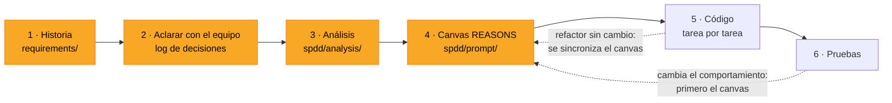

# Chat distribuido entre grupos

Proyecto final de Sistemas Distribuidos (Escuela de Ingeniería de Sistemas e
Informática, UIS). Un servidor de chat en contenedores que se conecta al servidor
central del curso, para que los usuarios de todos los grupos conversen en una sola sala
global, `#general`, con entrega al menos una vez, deduplicación, relojes de Lamport,
heartbeat y recuperación de historial.

El requerimiento se trabaja con **SPDD** (Structured Prompt-Driven Development): se
decide y se escribe la especificación antes de generar código, y cada decisión queda
registrada en este README.

## Estado

> **Fase actual: análisis, canvas de la estructura y código de la etapa 1 (pasos 3 a 5
> de SPDD).** Está la [historia](requirements/) con HU1–HU12, el
> [análisis](spdd/analysis/) del protocolo (provisional hasta que llegue la
> especificación, P07) y el [canvas de la estructura](spdd/prompt/) y el de la API local (CD-003, en revisión). Hay 24 decisiones
> tomadas y 6 pendientes. El trabajo está repartido en
> [23 issues y 5 milestones](#tareas-y-responsables), con entrega el **jueves 19 de
> noviembre**. El código de la etapa 1 (#3–#6) está en PR.



Verde: terminado. Amarillo: en curso. La historia está en borrador hasta que el equipo
la revise, y el análisis es provisional hasta que llegue la especificación (P07).

## Integrantes y roles

| Integrante | Código | Rol |
|---|---|---|
| Maria Fernanda Ruiz Velasquez | 2253689 | API local y cliente web |
| Javier Alexi Chacón Suárez | 2160044 | PM, estructura, documentación y póster |
| Karen Angelica Sandoval Martinez | 2253637 | Federación de mensajes: envío, recepción, Lamport, deduplicación, reintentos |
| Manuel Augusto Utrera Saltaren | Por definir | Presencia y recuperación: registro, heartbeat, historial; experimento |

Grupo: **gN**, por confirmar ([P01](#decisiones-pendientes)). El reparto es la decisión
[D03](#log-de-decisiones): cada integrante es dueño de un tramo del recorrido del mensaje
y todos escriben código.

## Qué vamos a construir

Arquitectura en estrella, según la sección 2 del enunciado. Nuestro servidor solo habla
con el servidor central y con nuestro cliente; nunca con los otros grupos.


Endpoints del protocolo (sección 4 del enunciado; manda la especificación OpenAPI,
[P07](#decisiones-pendientes)):

| Lado | Método y ruta | Qué hace |
|---|---|---|
| Central (lo llamamos) | `POST /register` | Registrar o renovar `{"server": "gN", "url": "http://…"}` |
| Central (lo llamamos) | `POST /messages` | Entregar un mensaje de un usuario nuestro |
| Central (lo llamamos) | `GET /history?since={lamport}` | Pedir lo posterior a una marca de Lamport |
| Central (lo llamamos) | `GET /health` | Heartbeat del central |
| Nuestro (nos llama) | `GET /fed/health` | Responde nombre del servidor y reloj de Lamport actual |
| Nuestro (nos llama) | `POST /fed/messages` | Recibir un mensaje reenviado por el central |

## Metodología: SPDD

SPDD es un método de Thoughtworks (Wei Zhang y Jessie Jie Xia, publicado en el sitio de
Martin Fowler en 2026) que trata los prompts como artefactos de ingeniería versionados
junto al código. El prompt estructurado se llama **canvas REASONS**:

| Letra | Sección | Pregunta que responde |
|---|---|---|
| R | Requirements | ¿Qué problema resolvemos y cuándo está terminado? |
| E | Entities | ¿Qué entidades hay y cómo se relacionan? |
| A | Approach | ¿Con qué estrategia lo resolvemos? |
| S | Structure | ¿Dónde encaja en el sistema? |
| O | Operations | ¿En qué pasos concretos y verificables se implementa? |
| N | Norms | ¿Qué convenciones aplican a todo? |
| S | Safeguards | ¿Qué no se puede romper nunca? |

Reglas que seguimos:

1. Primero la historia, después el análisis, después el canvas, y solo entonces el
   código, revisando en equipo entre cada paso.
2. **Cuando la realidad diverge, se corrige primero el canvas** y después el código.
   Un refactor que no cambia el comportamiento va al revés: código primero y luego se
   sincroniza el canvas.
3. SPDD no trae un log de decisiones propio. Lo agregamos aquí y cada decisión dice a
   qué sección del canvas alimenta, para que el canvas pueda citarla.

| Carpeta | Contenido |
|---|---|
| [`requirements/`](requirements/) | Historia y criterios de aceptación (paso 1), y el [enunciado del docente](requirements/enunciado/enunciado.md) |
| [`spdd/analysis/`](spdd/analysis/) | Análisis (paso 3): [contrato del protocolo y parámetros](spdd/analysis/CD-001-202611141940-[Analysis]-protocolo-y-parametros.md), y la especificación OpenAPI y el script de conformidad cuando lleguen |
| [`spdd/template/`](spdd/template/) | Plantilla del canvas REASONS |
| [`spdd/prompt/`](spdd/prompt/) | Canvas REASONS (paso 4): [CD-002, estructura](spdd/prompt/CD-002-202611141940-[Feat]-estructura.md). Cada área agrega el suyo |

Los archivos siguen el patrón del artículo: `ID-AAAAMMDDhhmm-[Tipo]-descripcion.md`, con
el prefijo `CD` (chat distribuido).

## Log de decisiones

La ronda 0 es lo que el equipo trajo decidido antes de iterar. La ronda 3 (2026-11-14) es la de la API local y el cliente web, con su [canvas](spdd/prompt/) (CD-003).

| ID | Decisión | Alternativas descartadas | Por qué | REASONS | Ronda |
|---|---|---|---|---|---|
| D01 | Metodología **SPDD** con log de decisiones en este README | Desarrollo directo sin especificación | Elección del equipo; deja trazable por qué el código es como es | N | 0 |
| D02 | **Repo propio del grupo** en GitHub: `Maria-Fernanda-Ruiz/Chat-distribuido` | — | Es trabajo en grupo y todos deben poder clonar y hacer push; el historial de commits se evalúa | S | 0 |
| D03 | **Reparto por flujo del mensaje.** Javier: PM, estructura (esqueleto, compose, configuración, persistencia, modelo, logging, central simulado), especificación, documentación y póster. Maria Fernanda: API local y cliente. Karen: federación de mensajes. Manuel: presencia y recuperación, y experimento. Cierra P02 | Por lado del protocolo; parejas por etapa; los cuatro roles del enunciado con póster compartido | Cada tramo del recorrido se prueba y se explica por separado, todos escriben código y la base común la hace una sola persona para que no haya cuatro estilos | O | 1 |
| D04 | **Seguimiento con GitHub Issues y un milestone por etapa del enunciado**; cada PR cierra su issue con `Closes #N` | Tablero de GitHub Projects; tabla en el repo | Enlaza cada tarea con su PR y deja visible la participación de cada integrante, que se evalúa con el historial | N | 1 |
| D05 | **Python 3.12 con FastAPI y httpx.** Cierra P03 | Node.js; Go | Lo recomienda el enunciado y el grupo ya lo usó en el curso; todos deben poder explicar cada línea | S | 1 |
| D06 | **SQLite en un volumen de Docker.** Cierra P04 | PostgreSQL en otro contenedor; Redis con AOF | Un solo contenedor; `UNIQUE(id)` hace la deduplicación atómica, y el reloj y los pendientes se guardan en la misma transacción | S | 1 |
| D07 | **Cliente web mínimo** (HTML y JS sin build) servido por el mismo FastAPI, que consulta el historial cada segundo. Cierra P05 | Línea de comandos; ambos | Se ve mejor en la demo y en el póster y no hay que instalar nada | S | 1 |
| D08 | **Entrega y sesión de interoperabilidad: jueves 19 de noviembre de 2026.** Un milestone por etapa: 15, 16, 17, 18 y 19 de noviembre | — | Fecha del curso; las etapas del enunciado tienen un punto de control verificable cada una | O | 1 |
| D09 | **Póster a partir de la plantilla en PowerPoint**, a cargo de Javier | LaTeX; Canva | Es el formato de partida; una sola persona mantiene el póster coherente mientras los demás programan | N | 1 |
| D10 | **Parámetros iniciales**, todos configurables por variables de entorno: heartbeat al central cada 5 s y caído tras 3 fallos seguidos; registro renovado cada 30 s; backoff de 1 s que se duplica hasta 30 s, con jitter y sin límite de intentos; timeout HTTP de 3 s. Cierra P09 | Valores rápidos para la demo (2 s, 2 fallos, 15 s, hasta 10 s); esperar a la especificación | Detecta la caída en 15–24 s sin falsos positivos por un timeout suelto. Sin límite de intentos, porque un tope perdería mensajes. El jitter evita que todos los grupos reintenten a la vez cuando vuelve el central | A | 2 |
| D11 | **El reloj de Lamport y la cola de pendientes se guardan en SQLite**, en la misma base que los mensajes. Cierra P10 | Tenerlos solo en memoria | Si el reloj vuelve a 0, nuestros mensajes nuevos quedan ordenados antes que los viejos; si se pierden los pendientes, se pierden mensajes | E | 2 |
| D12 | **Usuarios sin contraseña:** un nombre único en el grupo, de 1 a 20 caracteres entre minúsculas, números, `_` y `-`, para que `nombre@gN` sea válido en cualquier grupo. El cliente recuerda el nombre elegido. Cierra P11 | Contraseña con hash y token de sesión; token entregado al crear el usuario | El enunciado no pide autenticación, y cada cosa extra es trabajo para la API local y código que hay que saber explicar | E | 2 |
| D13 | **Todo en español:** código, API propia, commits y documentos. Los campos y rutas del protocolo con el central quedan como los define la especificación. Cierra P13 | Todo en inglés | El equipo y el curso trabajan en español; el protocolo no se negocia | N | 2 |
| D14 | **Flujo de Git:** una rama y un PR por cosa terminada (prefijos `docs/`, `feat/`, `fix/`), Conventional Commits y `Closes #N`; nunca push directo a `main`. Cierra P14 | Trabajar directo en `main` | Cada PR se revisa como una sola cosa y el historial muestra quién hizo qué, que también se evalúa | N | 2 |
| D15 | **El PM aprueba el canvas** para que el código pueda empezar; el equipo lo revisa en el PR y, si pide un cambio, primero se corrige el canvas. Ajusta la regla 1 de `AGENTS.md` | Esperar a que los cuatro lo revisen antes de programar | La etapa 1 vence el 15 de noviembre y las demás áreas no pueden programar sin la estructura | N | 2 |
| D16 | **`since` al recuperar historial:** al arrancar se pide `since=0` y la deduplicación descarta lo repetido; al volver el central se pide el último `lamport` visto. Cierra P15, que surgió en el análisis | Siempre el último visto; último visto menos un margen | Lamport no ordena los mensajes concurrentes: un grupo que acaba de arrancar puede mandar una marca menor que la nuestra, y con «último visto» lo perderíamos. Es justo lo que mide el experimento ([análisis, sección 6](spdd/analysis/CD-001-202611141940-[Analysis]-protocolo-y-parametros.md#6-qué-since-pedir-al-recuperar-historial-d16)) | A | 2 |
| D17 | **Rutas de la API local bajo `/api`:** `/api/usuarios` y `/api/mensajes` | `/v1/…`; rutas sin prefijo | Quedan separadas de las rutas `/fed/…` que usa el central y del cliente en `/` | S | 3 |
| D18 | **Crear usuario: 409 si el nombre ya existe y 422 si no cumple D12**, con `{"detail": "…"}` en español | 400 para los dos casos | Son los códigos estándar de HTTP y el cliente puede mostrar un mensaje distinto para cada caso | R | 3 |
| D19 | **El cliente pide lo nuevo por `lamport`** (`GET /api/mensajes?desde_lamport=N`), como dice [#22](https://github.com/Maria-Fernanda-Ruiz/Chat-distribuido/issues/22). Un mensaje concurrente que llega tarde con una marca menor o igual no aparece hasta recargar | Por `secuencia` (orden de llegada); pedir siempre todo | Decisión a propósito: la idea es **evidenciar** el comportamiento erróneo probable de un sistema distribuido (Lamport no ordena los concurrentes) y mostrarlo como hallazgo y caso de mejora en la sesión y el póster. La mejora, pedir por `secuencia`, queda escrita en el canvas | A | 3 |
| D20 | **Cliente: un color para los mensajes de nuestro grupo y otro para los de otros grupos**, y todos con la etiqueta `usuario@gN` | Solo la etiqueta; un color por grupo | Se distingue a simple vista en la demo y en el póster, con poco código | S | 3 |
| D21 | **Enviar con un usuario que no existe responde 404** | 422 | Es lo estándar cuando lo que se nombra no existe | R | 3 |
| D22 | **El texto del mensaje va de 1 a 1 000 caracteres;** vacío o solo espacios, o más de 1 000 → 422 | Solo no vacío; sin límites; 2 000 (Discord) o 4 000 (Telegram) | Evita mensajes en blanco en `#general` y textos enormes que viajan a todos los grupos, sin limitar un mensaje normal de chat | R | 3 |
| D23 | **El cliente web se abre en `/`** | `/cliente` | Es lo más cómodo en la demo: se abre la URL del servidor y aparece el chat | S | 3 |
| D24 | **El cliente web (#23) se programa antes de enviar (#21).** Cambia el orden de la sección O de CD-003 | Esperar a #12 y P16 sin avanzar | #21 depende del reloj de Karen (#12) y de P16. El cliente solo usa rutas ya fijadas en el canvas, así que puede ir antes; queda listo para enviar cuando llegue #21, sin cambiarlo | O | 3 |

## Decisiones pendientes

Se cierran con el equipo: cada pregunta se discute con sus opciones y, al decidir, pasa al
log como una D que dice «cierra P0X». No se genera código para una parte hasta cerrar su
pendiente.

| ID | Pregunta | Propuesta para discutir | Bloquea |
|---|---|---|---|
| P01 | ¿Qué número de grupo somos (`gN`)? | Preguntar al profesor o revisar la lista del curso | Configuración, póster |
| P06 | ¿Qué experimento? | Pérdidas ante una caída, porque mide lo mismo que muestra la demo (al menos una vez, deduplicación y recuperación). Lo cierra Manuel con el PM en [#19](https://github.com/Maria-Fernanda-Ruiz/Chat-distribuido/issues/19) | HU11, póster |
| P07 | ¿Dónde están la especificación OpenAPI, los ejemplos JSON y el script de conformidad? | Al 2026-11-14 no se han publicado. Javier pregunta al profesor y en el foro ([#1](https://github.com/Maria-Fernanda-Ruiz/Chat-distribuido/issues/1)); mientras tanto, los issues del protocolo llevan la etiqueta `protocolo-provisional` | Análisis (paso 3) y todo el protocolo |
| P08 | ¿Qué es el «modo alternativo» si el central no puede llamarnos? | Leerlo en la especificación cuando llegue (P07) | HU12 |
| P12 | ¿Cómo será alcanzable nuestra URL pública por el central (red de la sala, túnel)? | Depende de la red de la sesión y del modo alternativo (P08) | HU1, HU3, HU12 |
| P16 | La API local mueve el reloj, guarda el mensaje y lo encola en una sola transacción (CD-003, salvaguarda 3). ¿La función `tick()` de [#12](https://github.com/Maria-Fernanda-Ruiz/Chat-distribuido/issues/12) recibe la `Transaccion` abierta? | Que el reloj ofrezca `tick(tx)` además de la versión que abre su propia transacción. Lo acuerdan Karen y Maria Fernanda | [#21](https://github.com/Maria-Fernanda-Ruiz/Chat-distribuido/issues/21) |

## Tareas y responsables

Cada tarea es un issue con responsable, criterios de aceptación y dependencias, dentro
del [milestone](https://github.com/Maria-Fernanda-Ruiz/Chat-distribuido/milestones) de su etapa ([D04](#log-de-decisiones)). Los PR cierran su
issue con `Closes #N`. Los issues con la etiqueta `protocolo-provisional` salen del
resumen del enunciado y se revisan cuando llegue la especificación (P07).

| Etapa | Javier | Maria Fernanda | Karen | Manuel |
|---|---|---|---|---|
| 1 · Arranque (dom 15) | [#1](https://github.com/Maria-Fernanda-Ruiz/Chat-distribuido/issues/1) especificación y grupo<br>[#2](https://github.com/Maria-Fernanda-Ruiz/Chat-distribuido/issues/2) análisis y canvas<br>[#3](https://github.com/Maria-Fernanda-Ruiz/Chat-distribuido/issues/3) esqueleto<br>[#4](https://github.com/Maria-Fernanda-Ruiz/Chat-distribuido/issues/4) compose<br>[#5](https://github.com/Maria-Fernanda-Ruiz/Chat-distribuido/issues/5) SQLite<br>[#6](https://github.com/Maria-Fernanda-Ruiz/Chat-distribuido/issues/6) modelo y logs | — | — | — |
| 2 · Servidor local (lun 16) | [#7](https://github.com/Maria-Fernanda-Ruiz/Chat-distribuido/issues/7) central simulado | [#20](https://github.com/Maria-Fernanda-Ruiz/Chat-distribuido/issues/20) usuarios<br>[#21](https://github.com/Maria-Fernanda-Ruiz/Chat-distribuido/issues/21) enviar<br>[#22](https://github.com/Maria-Fernanda-Ruiz/Chat-distribuido/issues/22) historial<br>[#23](https://github.com/Maria-Fernanda-Ruiz/Chat-distribuido/issues/23) cliente web | [#12](https://github.com/Maria-Fernanda-Ruiz/Chat-distribuido/issues/12) reloj de Lamport | [#15](https://github.com/Maria-Fernanda-Ruiz/Chat-distribuido/issues/15) `/fed/health` |
| 3 · Conexión al central (mar 17) | [#8](https://github.com/Maria-Fernanda-Ruiz/Chat-distribuido/issues/8) conformidad | — | [#13](https://github.com/Maria-Fernanda-Ruiz/Chat-distribuido/issues/13) `/fed/messages`<br>[#14](https://github.com/Maria-Fernanda-Ruiz/Chat-distribuido/issues/14) envío con reintentos | [#16](https://github.com/Maria-Fernanda-Ruiz/Chat-distribuido/issues/16) registro<br>[#17](https://github.com/Maria-Fernanda-Ruiz/Chat-distribuido/issues/17) heartbeat<br>[#18](https://github.com/Maria-Fernanda-Ruiz/Chat-distribuido/issues/18) recuperar historial |
| 4 · Experimento (mié 18) | — | — | — | [#19](https://github.com/Maria-Fernanda-Ruiz/Chat-distribuido/issues/19) experimento |
| 5 · Cierre (jue 19) | [#9](https://github.com/Maria-Fernanda-Ruiz/Chat-distribuido/issues/9) README y diagrama<br>[#10](https://github.com/Maria-Fernanda-Ruiz/Chat-distribuido/issues/10) póster<br>[#11](https://github.com/Maria-Fernanda-Ruiz/Chat-distribuido/issues/11) bitácora y sustentación | — | — | — |

La base común (etapa 1) va primero porque las demás áreas programan sobre ella. Mientras
tanto, el resto del equipo revisa el análisis y el canvas ([#2](https://github.com/Maria-Fernanda-Ruiz/Chat-distribuido/issues/2)).

## Cómo levantarlo

Solo hace falta Docker con Compose. Todo corre en contenedores (regla 8 de
[`AGENTS.md`](AGENTS.md)).

```bash
cp .env.example .env          # llenar GRUPO, URL_PUBLICA y URL_CENTRAL
docker compose up --build     # servidor en http://localhost:8000
curl localhost:8000/fed/health
```

Si falta una variable obligatoria o un valor no es válido, el servidor no arranca y el
log dice cuál es. Cada variable está explicada en [`.env.example`](.env.example). Las
opcionales vacías toman los valores de [D10](#log-de-decisiones). Los datos (SQLite)
viven en el volumen `datos` y sobreviven a `docker compose restart`. `docker compose down
-v` los borra.

Para probar sin otros grupos hay un segundo archivo de compose, que no se entrega:

```bash
docker compose -f docker-compose.local.yml up --build              # gNa en :8001 y gNb en :8002
docker compose -f docker-compose.local.yml run --rm --build pruebas # todas las pruebas (pytest)
```

## Código

El servidor está en [`servidor/chat/`](servidor/chat/). La estructura y los contratos
entre módulos están en el [canvas CD-002](spdd/prompt/CD-002-202611141940-[Feat]-estructura.md).
Cada área programa en su carpeta, donde un archivo de partida explica qué va ahí:

| Carpeta | Qué hay | Responsable | Issues |
|---|---|---|---|
| [`chat/api_local/`](servidor/chat/api_local/) | API local y cliente web | Maria Fernanda | #20–#23 |
| [`chat/federacion/`](servidor/chat/federacion/) | Reloj de Lamport, `POST /fed/messages`, envío con reintentos | Karen | #12–#14 |
| [`chat/presencia/`](servidor/chat/presencia/) | `GET /fed/health`, registro, heartbeat, recuperación de historial | Manuel | #15–#18 |
| El resto de [`chat/`](servidor/chat/) | Configuración, contexto, arranque, almacén, modelo y eventos | Javier | #3–#6 |

Una tarea de fondo nueva se agrega a `TAREAS_DE_FONDO` en
[`principal.py`](servidor/chat/principal.py). Lo que comparten las áreas pasa por
[`Contexto`](servidor/chat/contexto.py); las áreas no se importan entre sí.

### Cómo registrar eventos

Los logs son la base del experimento y de la demo, así que todas las áreas registran
sus eventos con la misma función de [`eventos.py`](servidor/chat/eventos.py):

```python
from chat.eventos import Evento, registrar

registrar(Evento.REINTENTO, mensaje, intento=2, espera_s=1.7, causa="timeout")
```

```text
2026-11-14T19:40:05.210Z g3 REINTENTO id=6f1c2a9e-… lamport=42 origin=g3 from=ana@g3 intento=2 espera_s=1.7 causa=timeout
```

- Si se pasa el mensaje, la línea lleva su `id`, `lamport`, `origin` y `from`; después
  van los detalles en el orden en que se escriben.
- Un valor con espacios sale entre comillas, y un detalle `None` no sale.
- El cuerpo del mensaje nunca va al log.
- Los eventos y los campos de cada uno están en el
  [análisis, sección 10](spdd/analysis/CD-001-202611141940-[Analysis]-protocolo-y-parametros.md#10-eventos-del-log).
  Para agregar uno, primero se agrega al análisis y al canvas.

Los mensajes del protocolo se leen y se crean con [`Mensaje`](servidor/chat/modelo.py):

- `Mensaje.model_validate(json)` acepta campos desconocidos.
- `Mensaje.nuevo(usuario=…, grupo=…, lamport=…, body=…)` crea uno nuestro con un `id`
  nuevo.
- `mensaje.a_json()` lo deja listo para enviar, con `from`.

## Cómo continuar

Las instrucciones para cualquier persona o agente están en [`AGENTS.md`](AGENTS.md).
Cada integrante toma sus issues en el orden de los milestones. Antes de programar su
parte, cada área escribe su canvas sobre los contratos de la
[estructura](spdd/prompt/CD-002-202611141940-[Feat]-estructura.md) y lo aprueba el PM
(D15). Las preguntas nuevas se agregan como pendientes. Lo más urgente sigue siendo
conseguir la especificación (P07), que manda sobre todo lo provisional.

## Fuentes

- Wei Zhang y Jessie Jie Xia (Thoughtworks), [Structured-Prompt-Driven Development (SPDD)](https://martinfowler.com/articles/structured-prompt-driven/), martinfowler.com, 2026.
- Enunciado del docente: [`requirements/enunciado/`](requirements/enunciado/enunciado.md).
- Leslie Lamport, *Time, Clocks, and the Ordering of Events in a Distributed System*, Communications of the ACM, 1978.
- Vitillo, *Understanding Distributed Systems*.
