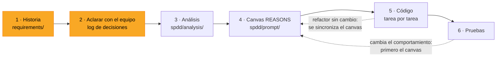
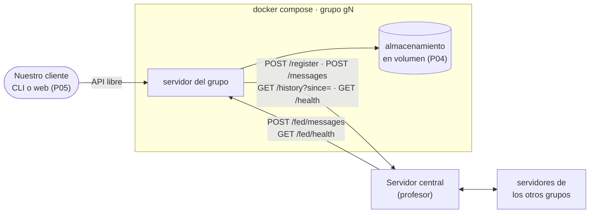

# Chat distribuido entre grupos

Proyecto final de Sistemas Distribuidos (Escuela de Ingeniería de Sistemas e
Informática, UIS). Un servidor de chat en contenedores que se conecta al servidor
central del curso, para que los usuarios de todos los grupos conversen en una sola sala
global, `#general`, con entrega al menos una vez, deduplicación, relojes de Lamport,
heartbeat y recuperación de historial.

El requerimiento se trabaja con **SPDD** (Structured Prompt-Driven Development): se
decide y se escribe la especificación antes de generar código, y cada decisión queda
registrada en este README.

## Estado

> **Fase actual: historia y preguntas al equipo (pasos 1 y 2 de SPDD).** Está la
> [historia](requirements/) con HU1–HU12, sacada del [enunciado](requirements/enunciado/enunciado.md).
> Hay 2 decisiones tomadas y 14 pendientes (P01–P14). **No hay código de la aplicación.**

Verde: terminado. Amarillo: en curso. La historia está en borrador hasta que el equipo
la revise.

## Integrantes y roles

| Integrante | Código | Rol |
|---|---|---|
| Maria Fernanda Ruiz Velasquez | 2253689 | Por decidir ([P02](#decisiones-pendientes)) |
| Javier Alexi Chacón Suárez | 2160044 | Por decidir ([P02](#decisiones-pendientes)) |
| Karen Angelica Sandoval Martinez | 2253637 | Por decidir ([P02](#decisiones-pendientes)) |
| Manuel Augusto Utrera Saltaren | Por definir | Por decidir ([P02](#decisiones-pendientes)) |

Grupo: **gN**, por confirmar ([P01](#decisiones-pendientes)). El enunciado sugiere
repartir: servidor, conexión con el servidor central, experimento y póster, sin que nadie
quede por fuera del código.

## Qué vamos a construir

Arquitectura en estrella, según la sección 2 del enunciado. Nuestro servidor solo habla
con el servidor central y con nuestro cliente; nunca con los otros grupos.

Endpoints del protocolo (sección 4 del enunciado; manda la especificación OpenAPI,
[P07](#decisiones-pendientes)):

| Lado | Método y ruta | Qué hace |
|---|---|---|
| Central (lo llamamos) | `POST /register` | Registrar o renovar `{"server": "gN", "url": "http://…"}` |
| Central (lo llamamos) | `POST /messages` | Entregar un mensaje de un usuario nuestro |
| Central (lo llamamos) | `GET /history?since={lamport}` | Pedir lo posterior a una marca de Lamport |
| Central (lo llamamos) | `GET /health` | Heartbeat del central |
| Nuestro (nos llama) | `GET /fed/health` | Responde nombre del servidor y reloj de Lamport actual |
| Nuestro (nos llama) | `POST /fed/messages` | Recibir un mensaje reenviado por el central |

## Metodología: SPDD

SPDD es un método de Thoughtworks (Wei Zhang y Jessie Jie Xia, publicado en el sitio de
Martin Fowler en 2026) que trata los prompts como artefactos de ingeniería versionados
junto al código. El prompt estructurado se llama **canvas REASONS**:

| Letra | Sección | Pregunta que responde |
|---|---|---|
| R | Requirements | ¿Qué problema resolvemos y cuándo está terminado? |
| E | Entities | ¿Qué entidades hay y cómo se relacionan? |
| A | Approach | ¿Con qué estrategia lo resolvemos? |
| S | Structure | ¿Dónde encaja en el sistema? |
| O | Operations | ¿En qué pasos concretos y verificables se implementa? |
| N | Norms | ¿Qué convenciones aplican a todo? |
| S | Safeguards | ¿Qué no se puede romper nunca? |

Reglas que seguimos:

1. Primero la historia, después el análisis, después el canvas, y solo entonces el
   código, revisando en equipo entre cada paso.
2. **Cuando la realidad diverge, se corrige primero el canvas** y después el código.
   Un refactor que no cambia el comportamiento va al revés: código primero y luego se
   sincroniza el canvas.
3. SPDD no trae un log de decisiones propio. Lo agregamos aquí y cada decisión dice a
   qué sección del canvas alimenta, para que el canvas pueda citarla.

| Carpeta | Contenido |
|---|---|
| [`requirements/`](requirements/) | Historia y criterios de aceptación (paso 1), y el [enunciado del docente](requirements/enunciado/enunciado.md) |
| [`spdd/analysis/`](spdd/analysis/) | Análisis (paso 3): la especificación OpenAPI y el script de conformidad, cuando lleguen |
| [`spdd/template/`](spdd/template/) | Plantilla del canvas REASONS |
| [`spdd/prompt/`](spdd/prompt/) | Canvas REASONS (paso 4), todavía vacío |

Los archivos siguen el patrón del artículo: `ID-AAAAMMDDhhmm-[Tipo]-descripcion.md`, con
el prefijo `CD` (chat distribuido).

## Log de decisiones

La ronda 0 es lo que el equipo trajo decidido antes de iterar.

| ID | Decisión | Alternativas descartadas | Por qué | REASONS | Ronda |
|---|---|---|---|---|---|
| D01 | Metodología **SPDD** con log de decisiones en este README | Desarrollo directo sin especificación | Elección del equipo; deja trazable por qué el código es como es | N | 0 |
| D02 | **Repo propio del grupo** en GitHub: `Maria-Fernanda-Ruiz/Chat-distribuido` | — | Es trabajo en grupo y todos deben poder clonar y hacer push; el historial de commits se evalúa | S | 0 |

## Decisiones pendientes

Se cierran con el equipo: cada pregunta se discute con sus opciones y, al decidir, pasa al
log como una D que dice «cierra P0X». No se genera código para una parte hasta cerrar su
pendiente.

| ID | Pregunta | Propuesta para discutir | Bloquea |
|---|---|---|---|
| P01 | ¿Qué número de grupo somos (`gN`)? | Preguntar al profesor o revisar la lista del curso | Configuración, póster |
| P02 | Integrantes y roles | Los cuatro roles del enunciado: servidor, conexión con el central, experimento, póster; todos con código | Reparto de tareas en Operations |
| P03 | ¿Lenguaje y framework del servidor? | Python + FastAPI + httpx, como recomienda el enunciado | Análisis, canvas |
| P04 | ¿Qué almacenamiento? | SQLite en un volumen (el más simple que cumple); alternativas: Redis con persistencia, PostgreSQL | HU2, canvas |
| P05 | ¿Cliente de línea de comandos o página web mínima? | Por discutir: la web luce mejor en la demo; la CLI es más rápida de hacer | HU9 |
| P06 | ¿Qué experimento? | Pérdidas ante una caída, latencia de extremo a extremo o tiempo de recuperación | HU11, póster |
| P07 | ¿Dónde están la especificación OpenAPI, los ejemplos JSON y el script de conformidad? | Pedirlos al profesor o buscarlos en Moodle y guardarlos en el repo; manda sobre el resumen del enunciado | Análisis (paso 3) y todo el protocolo |
| P08 | ¿Qué es el «modo alternativo» si el central no puede llamarnos? | Leerlo en la especificación cuando llegue (P07) | HU12 |
| P09 | Parámetros: intervalo de renovación del registro, intervalo del heartbeat, intentos para marcar caído, base y máximo del backoff | Fijarlos en el análisis, todos configurables por variables de entorno | HU3, HU5, HU7 |
| P10 | ¿El reloj de Lamport y la cola de pendientes se guardan para sobrevivir a un reinicio? | Sí, en el mismo almacenamiento; si no, el reloj podría retroceder | HU6, HU7, HU8 |
| P11 | ¿Los usuarios necesitan contraseña, o basta con el nombre? | Solo nombre: el enunciado no pide autenticación | HU2 |
| P12 | ¿Cómo será alcanzable nuestra URL pública por el central (red de la sala, túnel)? | Depende de la red de la sesión y del modo alternativo (P08) | HU1, HU3, HU12 |
| P13 | ¿Todo en español: código, API propia, commits y documentos? | Sí; el protocolo con el central se deja como lo define la especificación (en inglés) | Norms |
| P14 | Flujo de Git | Una rama y un PR por cosa terminada, Conventional Commits, nunca push directo a `main` (salvo el primer commit, que crea la rama) | Norms |

## Cómo continuar

Las instrucciones para cualquier persona o agente están en [`AGENTS.md`](AGENTS.md).
En resumen: lo siguiente es revisar la historia y cerrar los pendientes con el equipo
(paso 2), conseguir la especificación (P07) para el análisis (paso 3), y después escribir
el canvas (paso 4). Solo entonces empieza el código.

## Fuentes

- Wei Zhang y Jessie Jie Xia (Thoughtworks), [Structured-Prompt-Driven Development (SPDD)](https://martinfowler.com/articles/structured-prompt-driven/), martinfowler.com, 2026.
- Enunciado del docente: [`requirements/enunciado/`](requirements/enunciado/enunciado.md).
- Leslie Lamport, *Time, Clocks, and the Ordering of Events in a Distributed System*, Communications of the ACM, 1978.
- Vitillo, *Understanding Distributed Systems*.
