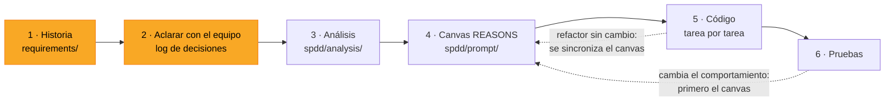
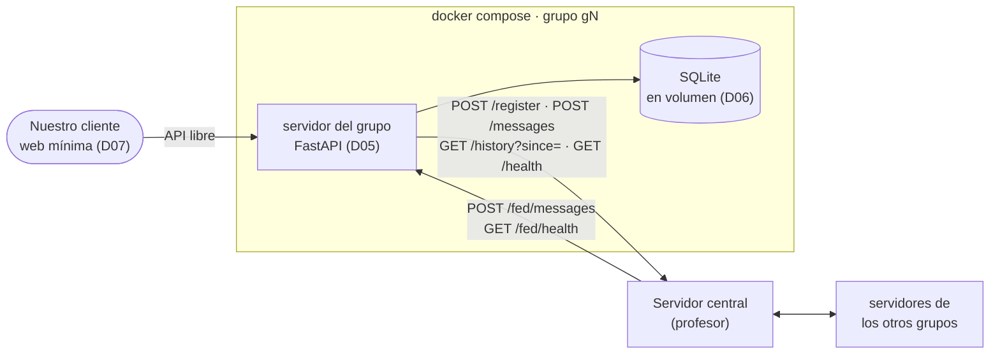

# Chat distribuido entre grupos

Proyecto final de Sistemas Distribuidos (Escuela de Ingeniería de Sistemas e
Informática, UIS). Un servidor de chat en contenedores que se conecta al servidor
central del curso, para que los usuarios de todos los grupos conversen en una sola sala
global, `#general`, con entrega al menos una vez, deduplicación, relojes de Lamport,
heartbeat y recuperación de historial.

El requerimiento se trabaja con **SPDD** (Structured Prompt-Driven Development): se
decide y se escribe la especificación antes de generar código, y cada decisión queda
registrada en este README.

## Estado

> **Fase actual: decisiones y reparto (paso 2 de SPDD).** Está la
> [historia](requirements/) con HU1–HU12, sacada del [enunciado](requirements/enunciado/enunciado.md).
> Hay 9 decisiones tomadas y 10 pendientes. El trabajo está repartido en
> [23 issues y 5 milestones](#tareas-y-responsables), con entrega el **jueves 19 de
> noviembre**. **No hay código de la aplicación.**

Verde: terminado. Amarillo: en curso. La historia está en borrador hasta que el equipo
la revise.

## Integrantes y roles

| Integrante | Código | Rol |
|---|---|---|
| Maria Fernanda Ruiz Velasquez | 2253689 | API local y cliente web |
| Javier Alexi Chacón Suárez | 2160044 | PM, estructura, documentación y póster |
| Karen Angelica Sandoval Martinez | 2253637 | Federación de mensajes: envío, recepción, Lamport, deduplicación, reintentos |
| Manuel Augusto Utrera Saltaren | Por definir | Presencia y recuperación: registro, heartbeat, historial; experimento |

Grupo: **gN**, por confirmar ([P01](#decisiones-pendientes)). El reparto es la decisión
[D03](#log-de-decisiones): cada integrante es dueño de un tramo del recorrido del mensaje
y todos escriben código.

## Qué vamos a construir

Arquitectura en estrella, según la sección 2 del enunciado. Nuestro servidor solo habla
con el servidor central y con nuestro cliente; nunca con los otros grupos.

Endpoints del protocolo (sección 4 del enunciado; manda la especificación OpenAPI,
[P07](#decisiones-pendientes)):

| Lado | Método y ruta | Qué hace |
|---|---|---|
| Central (lo llamamos) | `POST /register` | Registrar o renovar `{"server": "gN", "url": "http://…"}` |
| Central (lo llamamos) | `POST /messages` | Entregar un mensaje de un usuario nuestro |
| Central (lo llamamos) | `GET /history?since={lamport}` | Pedir lo posterior a una marca de Lamport |
| Central (lo llamamos) | `GET /health` | Heartbeat del central |
| Nuestro (nos llama) | `GET /fed/health` | Responde nombre del servidor y reloj de Lamport actual |
| Nuestro (nos llama) | `POST /fed/messages` | Recibir un mensaje reenviado por el central |

## Metodología: SPDD

SPDD es un método de Thoughtworks (Wei Zhang y Jessie Jie Xia, publicado en el sitio de
Martin Fowler en 2026) que trata los prompts como artefactos de ingeniería versionados
junto al código. El prompt estructurado se llama **canvas REASONS**:

| Letra | Sección | Pregunta que responde |
|---|---|---|
| R | Requirements | ¿Qué problema resolvemos y cuándo está terminado? |
| E | Entities | ¿Qué entidades hay y cómo se relacionan? |
| A | Approach | ¿Con qué estrategia lo resolvemos? |
| S | Structure | ¿Dónde encaja en el sistema? |
| O | Operations | ¿En qué pasos concretos y verificables se implementa? |
| N | Norms | ¿Qué convenciones aplican a todo? |
| S | Safeguards | ¿Qué no se puede romper nunca? |

Reglas que seguimos:

1. Primero la historia, después el análisis, después el canvas, y solo entonces el
   código, revisando en equipo entre cada paso.
2. **Cuando la realidad diverge, se corrige primero el canvas** y después el código.
   Un refactor que no cambia el comportamiento va al revés: código primero y luego se
   sincroniza el canvas.
3. SPDD no trae un log de decisiones propio. Lo agregamos aquí y cada decisión dice a
   qué sección del canvas alimenta, para que el canvas pueda citarla.

| Carpeta | Contenido |
|---|---|
| [`requirements/`](requirements/) | Historia y criterios de aceptación (paso 1), y el [enunciado del docente](requirements/enunciado/enunciado.md) |
| [`spdd/analysis/`](spdd/analysis/) | Análisis (paso 3): la especificación OpenAPI y el script de conformidad, cuando lleguen |
| [`spdd/template/`](spdd/template/) | Plantilla del canvas REASONS |
| [`spdd/prompt/`](spdd/prompt/) | Canvas REASONS (paso 4), todavía vacío |

Los archivos siguen el patrón del artículo: `ID-AAAAMMDDhhmm-[Tipo]-descripcion.md`, con
el prefijo `CD` (chat distribuido).

## Log de decisiones

La ronda 0 es lo que el equipo trajo decidido antes de iterar.

| ID | Decisión | Alternativas descartadas | Por qué | REASONS | Ronda |
|---|---|---|---|---|---|
| D01 | Metodología **SPDD** con log de decisiones en este README | Desarrollo directo sin especificación | Elección del equipo; deja trazable por qué el código es como es | N | 0 |
| D02 | **Repo propio del grupo** en GitHub: `Maria-Fernanda-Ruiz/Chat-distribuido` | — | Es trabajo en grupo y todos deben poder clonar y hacer push; el historial de commits se evalúa | S | 0 |
| D03 | **Reparto por flujo del mensaje.** Javier: PM, estructura (esqueleto, compose, configuración, persistencia, modelo, logging, central simulado), especificación, documentación y póster. Maria Fernanda: API local y cliente. Karen: federación de mensajes. Manuel: presencia y recuperación, y experimento. Cierra P02 | Por lado del protocolo; parejas por etapa; los cuatro roles del enunciado con póster compartido | Cada tramo del recorrido se prueba y se explica por separado, todos escriben código y la base común la hace una sola persona para que no haya cuatro estilos | O | 1 |
| D04 | **Seguimiento con GitHub Issues y un milestone por etapa del enunciado**; cada PR cierra su issue con `Closes #N` | Tablero de GitHub Projects; tabla en el repo | Enlaza cada tarea con su PR y deja visible la participación de cada integrante, que se evalúa con el historial | N | 1 |
| D05 | **Python 3.12 con FastAPI y httpx.** Cierra P03 | Node.js; Go | Lo recomienda el enunciado y el grupo ya lo usó en el curso; todos deben poder explicar cada línea | S | 1 |
| D06 | **SQLite en un volumen de Docker.** Cierra P04 | PostgreSQL en otro contenedor; Redis con AOF | Un solo contenedor; `UNIQUE(id)` hace la deduplicación atómica, y el reloj y los pendientes se guardan en la misma transacción | S | 1 |
| D07 | **Cliente web mínimo** (HTML y JS sin build) servido por el mismo FastAPI, que consulta el historial cada segundo. Cierra P05 | Línea de comandos; ambos | Se ve mejor en la demo y en el póster y no hay que instalar nada | S | 1 |
| D08 | **Entrega y sesión de interoperabilidad: jueves 19 de noviembre de 2026.** Un milestone por etapa: 15, 16, 17, 18 y 19 de noviembre | — | Fecha del curso; las etapas del enunciado tienen un punto de control verificable cada una | O | 1 |
| D09 | **Póster a partir de la plantilla en PowerPoint**, a cargo de Javier | LaTeX; Canva | Es el formato de partida; una sola persona mantiene el póster coherente mientras los demás programan | N | 1 |

## Decisiones pendientes

Se cierran con el equipo: cada pregunta se discute con sus opciones y, al decidir, pasa al
log como una D que dice «cierra P0X». No se genera código para una parte hasta cerrar su
pendiente.

| ID | Pregunta | Propuesta para discutir | Bloquea |
|---|---|---|---|
| P01 | ¿Qué número de grupo somos (`gN`)? | Preguntar al profesor o revisar la lista del curso | Configuración, póster |
| P06 | ¿Qué experimento? | Pérdidas ante una caída, porque mide lo mismo que muestra la demo (al menos una vez, deduplicación y recuperación). Lo cierra Manuel con el PM en [#19](https://github.com/Maria-Fernanda-Ruiz/Chat-distribuido/issues/19) | HU11, póster |
| P07 | ¿Dónde están la especificación OpenAPI, los ejemplos JSON y el script de conformidad? | Al 2026-11-14 no se han publicado. Javier pregunta al profesor y en el foro ([#1](https://github.com/Maria-Fernanda-Ruiz/Chat-distribuido/issues/1)); mientras tanto, los issues del protocolo llevan la etiqueta `protocolo-provisional` | Análisis (paso 3) y todo el protocolo |
| P08 | ¿Qué es el «modo alternativo» si el central no puede llamarnos? | Leerlo en la especificación cuando llegue (P07) | HU12 |
| P09 | Parámetros: intervalo de renovación del registro, intervalo del heartbeat, intentos para marcar caído, base y máximo del backoff | Fijarlos en el análisis, todos configurables por variables de entorno | HU3, HU5, HU7 |
| P10 | ¿El reloj de Lamport y la cola de pendientes se guardan para sobrevivir a un reinicio? | Sí, en el mismo almacenamiento; si no, el reloj podría retroceder | HU6, HU7, HU8 |
| P11 | ¿Los usuarios necesitan contraseña, o basta con el nombre? | Solo nombre: el enunciado no pide autenticación | HU2 |
| P12 | ¿Cómo será alcanzable nuestra URL pública por el central (red de la sala, túnel)? | Depende de la red de la sesión y del modo alternativo (P08) | HU1, HU3, HU12 |
| P13 | ¿Todo en español: código, API propia, commits y documentos? | Sí; el protocolo con el central se deja como lo define la especificación (en inglés) | Norms |
| P14 | Flujo de Git | Una rama y un PR por cosa terminada, Conventional Commits, nunca push directo a `main` (salvo el primer commit, que crea la rama) | Norms |

## Tareas y responsables

Cada tarea es un issue con responsable, criterios de aceptación y dependencias, dentro
del [milestone](https://github.com/Maria-Fernanda-Ruiz/Chat-distribuido/milestones) de su etapa ([D04](#log-de-decisiones)). Los PR cierran su
issue con `Closes #N`. Los issues con la etiqueta `protocolo-provisional` salen del
resumen del enunciado y se revisan cuando llegue la especificación (P07).

| Etapa | Javier | Maria Fernanda | Karen | Manuel |
|---|---|---|---|---|
| 1 · Arranque (dom 15) | [#1](https://github.com/Maria-Fernanda-Ruiz/Chat-distribuido/issues/1) especificación y grupo [#2](https://github.com/Maria-Fernanda-Ruiz/Chat-distribuido/issues/2) análisis y canvas [#3](https://github.com/Maria-Fernanda-Ruiz/Chat-distribuido/issues/3) esqueleto [#4](https://github.com/Maria-Fernanda-Ruiz/Chat-distribuido/issues/4) compose [#5](https://github.com/Maria-Fernanda-Ruiz/Chat-distribuido/issues/5) SQLite [#6](https://github.com/Maria-Fernanda-Ruiz/Chat-distribuido/issues/6) modelo y logs | — | — | — |
| 2 · Servidor local (lun 16) | [#7](https://github.com/Maria-Fernanda-Ruiz/Chat-distribuido/issues/7) central simulado | [#20](https://github.com/Maria-Fernanda-Ruiz/Chat-distribuido/issues/20) usuarios [#21](https://github.com/Maria-Fernanda-Ruiz/Chat-distribuido/issues/21) enviar [#22](https://github.com/Maria-Fernanda-Ruiz/Chat-distribuido/issues/22) historial [#23](https://github.com/Maria-Fernanda-Ruiz/Chat-distribuido/issues/23) cliente web | [#12](https://github.com/Maria-Fernanda-Ruiz/Chat-distribuido/issues/12) reloj de Lamport | [#15](https://github.com/Maria-Fernanda-Ruiz/Chat-distribuido/issues/15) `/fed/health` |
| 3 · Conexión al central (mar 17) | [#8](https://github.com/Maria-Fernanda-Ruiz/Chat-distribuido/issues/8) conformidad | — | [#13](https://github.com/Maria-Fernanda-Ruiz/Chat-distribuido/issues/13) `/fed/messages` [#14](https://github.com/Maria-Fernanda-Ruiz/Chat-distribuido/issues/14) envío con reintentos | [#16](https://github.com/Maria-Fernanda-Ruiz/Chat-distribuido/issues/16) registro [#17](https://github.com/Maria-Fernanda-Ruiz/Chat-distribuido/issues/17) heartbeat [#18](https://github.com/Maria-Fernanda-Ruiz/Chat-distribuido/issues/18) recuperar historial |
| 4 · Experimento (mié 18) | — | — | — | [#19](https://github.com/Maria-Fernanda-Ruiz/Chat-distribuido/issues/19) experimento |
| 5 · Cierre (jue 19) | [#9](https://github.com/Maria-Fernanda-Ruiz/Chat-distribuido/issues/9) README y diagrama [#10](https://github.com/Maria-Fernanda-Ruiz/Chat-distribuido/issues/10) póster [#11](https://github.com/Maria-Fernanda-Ruiz/Chat-distribuido/issues/11) bitácora y sustentación | — | — | — |

La base común (etapa 1) va primero porque las demás áreas programan sobre ella. Mientras
tanto, el resto del equipo revisa el análisis y el canvas ([#2](https://github.com/Maria-Fernanda-Ruiz/Chat-distribuido/issues/2)). Las
tareas de Manuel quedan sin asignar en GitHub hasta que acepte la invitación al repo.

## Cómo continuar

Las instrucciones para cualquier persona o agente están en [`AGENTS.md`](AGENTS.md).
Cada integrante toma sus issues en el orden de los milestones. Antes de programar una
parte se revisa su canvas, y las preguntas nuevas se agregan como pendientes. Lo más
urgente es conseguir la especificación (P07): manda sobre todo lo provisional.

## Fuentes

- Wei Zhang y Jessie Jie Xia (Thoughtworks), [Structured-Prompt-Driven Development (SPDD)](https://martinfowler.com/articles/structured-prompt-driven/), martinfowler.com, 2026.
- Enunciado del docente: [`requirements/enunciado/`](requirements/enunciado/enunciado.md).
- Leslie Lamport, *Time, Clocks, and the Ordering of Events in a Distributed System*, Communications of the ACM, 1978.
- Vitillo, *Understanding Distributed Systems*.
