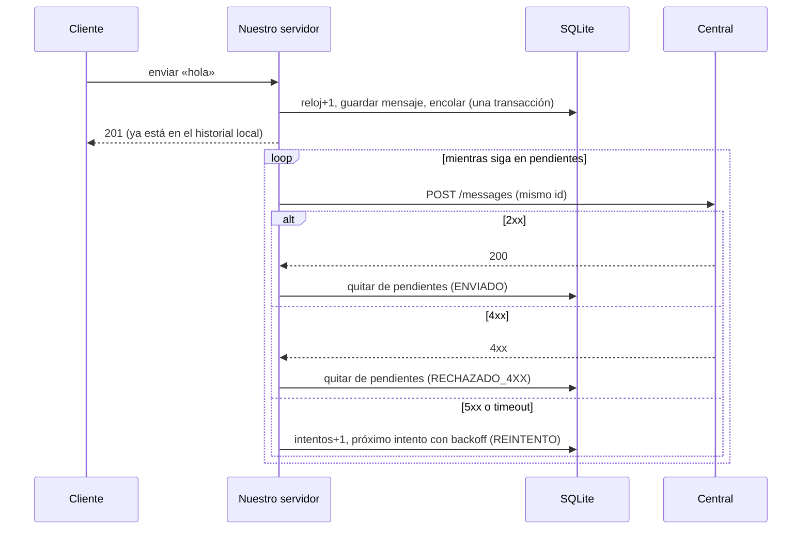
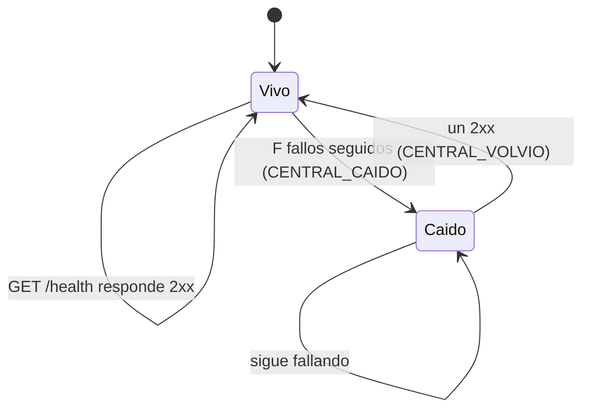

# CD-001 · Análisis: contrato del protocolo y parámetros

| Campo | Valor |
|---|---|
| ID | CD-001 (análisis de la historia [CD-001](../../requirements/CD-001-202611132125-[Story]-chat-distribuido.md)) |
| Tipo | Análisis (paso 3 de SPDD) |
| Estado | **Revisado contra la [especificación v1.0.0](https://github.com/javierchacon262/central-server-dsp/tree/main/especificacion)** del central el 2026-11-16 (D27). El resultado de cada supuesto está en la sección 11 |
| Fecha | 2026-11-14 |
| Decisiones que usa | D05, D06, D10–D16, D27 |
| Lo usan | El canvas de la estructura [CD-002](../prompt/CD-002-202611141940-[Feat]-estructura.md) y los canvas de cada área |

Este documento fija **qué hace el servidor en cada caso** antes de escribir código. Lo
que no dice el enunciado está marcado como supuesto (**S1–S9**, sección 11). Cuando
llegue la especificación, esa lista es la que se revisa: si un supuesto falla, se corrige
aquí, luego el canvas y luego el código.

## 1. Principio: estrictos al enviar, tolerantes al recibir

Interoperamos con implementaciones que no controlamos. Si rechazamos un mensaje de otro
grupo porque trae `sent_at` en otro formato, ese mensaje **falta en nuestra pantalla**, y
en el experimento cuenta como pérdida. Por eso:

- **Al enviar** cumplimos el formato al pie de la letra: UUID v4 en `id`, `sent_at` en
  ISO 8601 UTC con `Z` y `from` con la forma `usuario@gN`.
- **Al recibir** solo exigimos lo imprescindible para deduplicar y ordenar: un `id` no
  vacío y un `lamport` entero. Lo demás se acepta como venga y los campos desconocidos se
  ignoran sin error (regla de la sección 4).

## 2. Formato del mensaje

| Campo | Tipo | Lo pone | Al enviar | Al recibir |
|---|---|---|---|---|
| `id` | texto | servidor de origen | UUID v4 nuevo, **nunca cambia**, ni al reintentar | Obligatorio, no vacío, hasta 100 caracteres. Es la clave de deduplicación |
| `from` | texto | servidor de origen | `usuario@gN`, con el usuario validado por D12 | Obligatorio, no vacío; no se valida la forma |
| `origin` | texto | servidor de origen | El valor de `GRUPO` | Obligatorio, no vacío; desempata el orden |
| `lamport` | entero ≥ 0 | servidor de origen | El reloj **después** de incrementarlo (sección 5) | Obligatorio; se rechaza si supera 2⁶² (protege el reloj y el entero de SQLite) |
| `sent_at` | texto | servidor de origen | `AAAA-MM-DDThh:mm:ssZ` en UTC | Se guarda tal como viene y **nunca se usa para ordenar** |
| `body` | texto | usuario | El límite lo fija la API local (#21) | Hasta 10 000 caracteres |

Un mensaje recibido al que le falte `id` o `lamport`, o cuyo `lamport` no sea entero, no
se puede deduplicar ni ordenar: se responde `422` (S2) y queda en el log.

## 3. Endpoints del central (los llamamos nosotros)

| Llamada | Cuándo | `2xx` | `4xx` | `5xx`, timeout o sin conexión |
|---|---|---|---|---|
| `POST /register` con `{"server", "url"}` | Al arrancar, cada `REGISTRO_INTERVALO_S` y al volver el central | `REGISTRADO` en el log | `RECHAZADO_4XX`; no se reintenta, pero la renovación periódica sigue y vuelve a dejarlo en el log | Se intenta de nuevo en la siguiente renovación |
| `POST /messages` con el mensaje | Hay pendientes y el central no está marcado caído | `ENVIADO`; se quita de pendientes | `RECHAZADO_4XX`; se quita de pendientes **sin reintentar** | `REINTENTO`; se reprograma con backoff (sección 7), **mismo `id`** |
| `GET /history?after_seq={cursor}&server={GRUPO}` | En pull (D27), cada `PULL_INTERVALO_S`; una página llena (1000) se sigue pidiendo de inmediato | Cada mensaje entra por la misma recepción de la sección 4 y el cursor avanza en la misma transacción | `RECHAZADO_4XX` | Se intenta de nuevo en el siguiente ciclo |
| `GET /history?since={L}` | Solo en push: al arrancar (`since=0`) y al volver el central (`since` = último visto), D16 | Cada mensaje entra por la misma recepción de la sección 4; al final `HISTORIAL_RECUPERADO` | `RECHAZADO_4XX` | Se reintenta con backoff hasta que funcione |
| `GET /health` | Cada `HEARTBEAT_INTERVALO_S` | El central está vivo | Cuenta como fallo | Cuenta como fallo |

Cada llamada usa un timeout de `HTTP_TIMEOUT_S`. Un `3xx` se trata como `4xx`: no se
reintenta y se registra.

## 4. Endpoints nuestros (los llama el central)

### `GET /fed/health`

Responde `200` con el nombre del servidor y el reloj actual:
`{"server": "gN", "lamport": 57}` (nombres de campo, S6). Solo lee el reloj, no lo
modifica, y no hace llamadas de red: tiene que responder rápido aunque el central esté
lento. La versión de la estructura (#3) devuelve solo `server`; presencia (#15) agrega
`lamport`.

### `POST /fed/messages`

| Caso | Qué pasa | Respuesta | Log |
|---|---|---|---|
| `id` nuevo | Se guarda y el reloj pasa a `max(local, recibido) + 1`, **en la misma transacción** | `200` | `RECIBIDO` |
| `id` ya conocido | Nada: ni se guarda ni se toca el reloj | `200` (idempotente) | `DUPLICADO_DESCARTADO` |
| Falta `id` o `lamport`, o `lamport` no es entero | Nada | `422` (S2) | Error de validación |
| `origin` es nuestro propio grupo | Igual que los demás: por el `id` ya lo tenemos y sale como duplicado | `200` | `DUPLICADO_DESCARTADO` |

El cuerpo de la respuesta es `{"duplicate": false}` o `{"duplicate": true}` (S7). No le
sirve al central, pero ayuda a depurar.

## 5. Reloj de Lamport

Un solo contador entero por servidor, guardado en SQLite (D11), que **nunca retrocede**.

| Evento | Regla | Atomicidad |
|---|---|---|
| Un usuario nuestro envía | `L ← L + 1`; el mensaje lleva `lamport = L` | En una transacción: subir el reloj, guardar el mensaje y encolarlo en pendientes |
| Llega un mensaje nuevo (`/fed/messages` o historial) | `L ← max(L, m.lamport) + 1` | En una transacción con el guardado |
| Llega un duplicado | Sin efecto | — |
| `GET /fed/health` | Se lee `L` | Solo lectura |

Lo que se guarda en el historial es el `lamport` **del mensaje**, el que puso el origen, y
no el valor de nuestro reloj al recibirlo: así todos los servidores ordenan con las mismas
marcas.

**Orden del historial:** `(lamport, origin)`, como pide el requisito 7, y luego `id` como
tercer criterio. Un mismo origen nunca repite marca, porque su reloj solo sube; el `id`
solo hace que el orden sea idéntico en cualquier máquina aunque otro grupo tenga un
error.

## 6. Qué `since` pedir al recuperar historial (D16)

Lamport garantiza que si un mensaje **causó** otro, el primero tiene una marca menor. No
garantiza nada para mensajes **concurrentes**. Ejemplo:

1. Nuestro servidor vio mensajes hasta `lamport = 120` y se apaga.
2. Mientras tanto arranca `g5`, que todavía no ha recibido nada (reloj en 0), y su
   usuario escribe «hola»: el mensaje sale con `lamport = 1`.
3. Al volver, si pedimos `since=120` el central no nos manda «hola» y lo perdemos sin
   enterarnos.

Por eso, según D16:

- **Al arrancar se pide `since=0`.** Llega todo el historial y la deduplicación descarta
  lo que ya teníamos. Es justo el caso que mide el experimento (P06), y el historial de
  un curso es pequeño: 5000 mensajes de unos 300 bytes son 1,5 MB.
- **Al volver el central (nosotros seguimos vivos) se pide `since` = último visto**, que
  es el mayor `lamport` guardado. El riesgo del ejemplo sigue ahí, pero es menor, porque
  mientras el central estuvo caído nadie pudo enviar a través de él. Si en la sesión de
  interoperabilidad aparece una pérdida así, es un hallazgo para la bitácora y el póster.

El último visto **se calcula** como `MAX(lamport)` sobre los mensajes guardados en lugar
de guardarse aparte: así hay una sola fuente de verdad y no se puede desincronizar.

## 7. Envío con reintentos y cola de pendientes

Todo mensaje de un usuario nuestro se guarda **primero en pendientes**, en la misma
transacción en que se crea. El usuario lo ve de inmediato en su historial, y el envío al
central ocurre en segundo plano:



- **Backoff:** la espera del intento *n* es `min(BACKOFF_MAX_S, BACKOFF_BASE_S · 2ⁿ⁻¹)`;
  con los valores de D10: 1 s, 2 s, 4 s, 8 s, 16 s, 30 s, 30 s… Se duerme un valor
  aleatorio entre la mitad de esa espera y la espera completa (*jitter*). Así, cuando el
  central vuelve, los grupos no reintentan todos en el mismo instante.
- **Sin límite de intentos:** si tuviera un tope, el mensaje se perdería y dejaría de ser
  entrega al menos una vez.
- **Orden de envío:** los pendientes listos salen en orden de `lamport`.
- **Con el central marcado caído no se intenta nada.** Cuando vuelve, todos los
  pendientes pasan a estar listos y salen en orden.
- Los pendientes están en SQLite (D11), así que sobreviven a un reinicio.
- Un `4xx` deja el mensaje en nuestro historial aunque nadie más lo vea. La API local o
  el cliente pueden marcarlo como no entregado; eso lo decide #21 o #23.

## 8. Detección de caída del central



- Se arranca en **Vivo**. El registro y el historial del arranque se piden de todas
  formas, y si el central no está, los reintentos y el heartbeat lo descubren.
- `F = HEARTBEAT_FALLOS_PARA_CAIDO`. Con D10, la caída se detecta entre 15 s y 24 s
  después: 3 intervalos de 5 s más, como mucho, 3 timeouts de 3 s.
- **Al pasar a Caído:** se registra `CENTRAL_CAIDO` y el envío se pausa.
- **Al volver:** se registra `CENTRAL_VOLVIO` y luego, en este orden: se renueva el
  registro de inmediato, se recupera el historial con `since` = último visto y se
  reanudan los pendientes.
- El estado Vivo o Caído se comparte entre presencia, que lo cambia, y federación, que lo
  consulta antes de enviar. La estructura (CD-002) define ese punto de contacto.

## 9. Parámetros (D10)

Todos son variables de entorno. Si una viene vacía se usa el valor por defecto.

| Variable | Por defecto | Qué controla | La usa |
|---|---|---|---|
| `GRUPO` | **obligatoria** | Nombre del servidor en el central (`gN`, P01) | todas |
| `URL_PUBLICA` | obligatoria **solo en push** | URL con la que el central nos llama; en pull, si se da, se informa en el registro (D27) | registro |
| `MODO_RECEPCION` | `pull` | `pull`: consultamos al central; `push`: el central nos llama (D27) | presencia |
| `PULL_INTERVALO_S` | 1,5 | Cada cuánto se consulta `GET /history?after_seq=` en pull | presencia |
| `URL_CENTRAL` | **obligatoria** | URL del central; el del curso es `https://dsp.cshire.io` | federación, presencia |
| `HEARTBEAT_INTERVALO_S` | 5 | Cada cuánto se consulta `GET /health` | presencia |
| `HEARTBEAT_FALLOS_PARA_CAIDO` | 3 | Fallos seguidos para marcar caído | presencia |
| `REGISTRO_INTERVALO_S` | 30 | Cada cuánto se renueva el registro | presencia |
| `BACKOFF_BASE_S` | 1 | Primera espera de un reintento | federación |
| `BACKOFF_MAX_S` | 30 | Espera máxima entre reintentos | federación |
| `HTTP_TIMEOUT_S` | 3 | Timeout de cada llamada al central | todas |
| `RUTA_BD` | `/datos/chat.db` | Archivo SQLite, dentro del volumen | estructura |
| `PUERTO` | 8000 | Puerto dentro del contenedor | estructura |
| `LOG_ACCESOS` | `false` | Mostrar también una línea por cada petición HTTP | estructura |

Si falta una obligatoria o un valor no es válido, el servidor **no arranca** y dice cuál
es y cómo corregirlo (#3).

## 10. Eventos del log

Una línea por evento, legible por personas y fácil de procesar con un script para el
experimento:

```text
2026-11-14T19:40:03.512Z gN ENVIADO id=6f1c2a9e-4b7d-4f0e-9a51-2c8e7d3b1f44 lamport=42 origin=gN from=ana@gN intento=1
```

| Evento | Cuándo | Campos además de `id`, `lamport`, `origin` y `from` |
|---|---|---|
| `ARRANQUE` | El servidor arrancó | `reloj`, `mensajes`, `pendientes`, `central` |
| `PARADA` | El servidor se está deteniendo | `pendientes` |
| `ENCOLADO` | Un mensaje nuestro entró a pendientes | — |
| `ENVIADO` | El central respondió `2xx` a `POST /messages` | `intento` |
| `REINTENTO` | `5xx`, timeout o sin conexión; se reprograma | `intento`, `espera_s`, `causa` |
| `RECHAZADO_4XX` | El central respondió `4xx` | `estado`, `ruta` |
| `RECIBIDO` | Llegó un mensaje nuevo y se guardó | `via` (`fed`, `pull` o `historial`), `reloj` |
| `DUPLICADO_DESCARTADO` | Llegó un `id` que ya teníamos | `via` |
| `REGISTRADO` | El central aceptó el registro | `url` |
| `CENTRAL_CAIDO` | F fallos seguidos de `GET /health` | `fallos` |
| `CENTRAL_VOLVIO` | Primer `2xx` después de estar caído | `caido_s` |
| `HISTORIAL_RECUPERADO` | Terminó una recuperación: en push la de `since`; en pull la primera consulta completa después de arrancar o de volver el central | `since` o `after_seq`, `nuevos`, `duplicados` |

El cuerpo del mensaje no va al log: no hace falta para depurar ni para medir.

## 11. Supuestos que se revisan contra la especificación

| ID | Supuesto | Si falla, cambia |
|---|---|---|
| S1 | Los nombres de campo del mensaje son los del ejemplo de la sección 4 | Modelo `Mensaje` (#6) |
| S2 | Un mensaje inválido se responde con `422` (lo que hace FastAPI por defecto) | Manejo de errores de `/fed/messages` (#13) |
| S3 | `POST /register` responde `2xx` y su cuerpo no importa | Registro (#16) |
| S4 | `GET /history` devuelve una lista JSON de mensajes y no un objeto que la envuelve | Recuperación (#18) |
| S5 | `since` es exclusivo (`lamport > since`). Si es inclusivo no pasa nada: el duplicado se descarta | — |
| S6 | `GET /fed/health` responde con los campos `server` y `lamport` | `/fed/health` (#15) |
| S7 | El central ignora el cuerpo de nuestra respuesta a `/fed/messages` | `/fed/messages` (#13) |
| S8 | El registro no expira antes de 30 s; si la especificación da un TTL, la renovación va a la mitad | `REGISTRO_INTERVALO_S` (D10) |
| S9 | El «modo alternativo» (P08) no cambia los endpoints, solo quién inicia la conexión | Presencia y federación |

### Resultado de la revisión contra la especificación v1.0.0 (2026-11-16)

| ID | Resultado | Qué cambió |
|---|---|---|
| S1 | Se cumple. En `/history` y en push cada mensaje trae además `seq` | Nada en `Mensaje`; el pull lee `seq` aparte |
| S2 | El central responde `400` a lo inválido. Para `/fed/messages` la especificación acepta cualquier `4xx` como rechazo | Se mantiene `422` |
| S3 | Se cumple: `200` con `{"server", "url", "mode", "new"}` | El registro lee `new` solo para el log |
| S4 | Se cumple: lista JSON | — |
| S5 | **Falla:** `since` es inclusivo (`lamport ≥ since`) | Nada: los repetidos se descartan por `id` |
| S6 | Se cumple: `{"server", "lamport"}` | `/fed/health` agrega `lamport` (#15) |
| S7 | Se cumple: el central no lee el cuerpo | — |
| S8 | Se cumple: el registro no vence; se recomienda renovarlo cada 30 s | — |
| S9 | **Falla:** el modo alternativo es **pull**: el grupo consulta `GET /history?after_seq=` y el central no lo llama | D27: pull por defecto; push con `MODO_RECEPCION=push` |

## 12. Arranque y parada

**Arranque:**

1. Leer la configuración; si es inválida, salir con el error.
2. Abrir SQLite y crear las tablas si no existen.
3. Registrar `ARRANQUE` con el reloj y los pendientes que quedaron guardados.
4. Lanzar las tareas de fondo, que corren a la vez y ninguna bloquea el arranque:
   - registro inmediato y renovación periódica;
   - en pull, la consulta por cursor (D27); en push, la recuperación con `since=0`;
   - heartbeat;
   - envío de pendientes.
5. La API empieza a responder, incluido `/fed/health`.

**Parada** (`docker compose stop`, que manda `SIGTERM`): se cancelan las tareas de fondo,
se registra `PARADA` y el proceso termina en menos de 2 s. Los pendientes quedan en
SQLite y se reanudan al arrancar. No se espera a vaciar la cola, porque eso podría tardar
indefinidamente si el central está caído.
