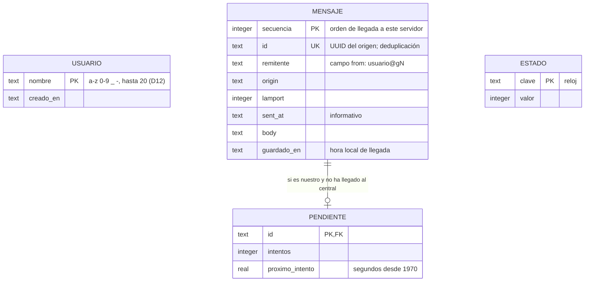
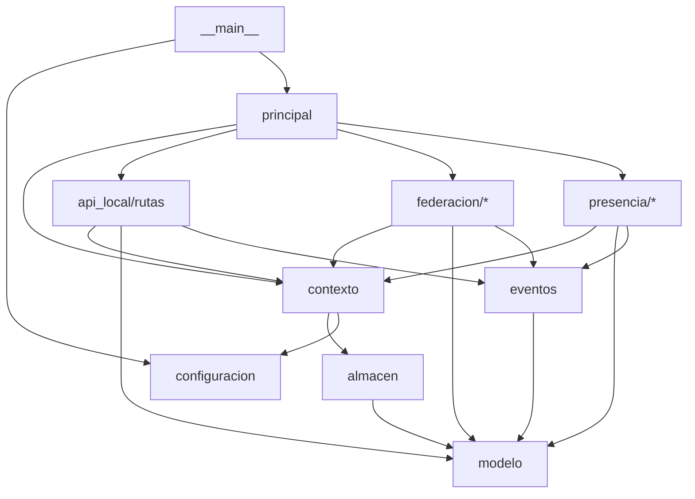

# CD-002 · Canvas REASONS: estructura del servidor

| Campo | Valor |
|---|---|
| ID | CD-002 |
| Historia | [CD-001](../../requirements/CD-001-202611132125-[Story]-chat-distribuido.md): HU1, HU2, HU4, HU10, y la base de HU3 y HU5–HU8 |
| Análisis | [CD-001 · protocolo y parámetros](../analysis/CD-001-202611141940-[Analysis]-protocolo-y-parametros.md) |
| Issues | [#3](https://github.com/Maria-Fernanda-Ruiz/Chat-distribuido/issues/3), [#4](https://github.com/Maria-Fernanda-Ruiz/Chat-distribuido/issues/4), [#5](https://github.com/Maria-Fernanda-Ruiz/Chat-distribuido/issues/5), [#6](https://github.com/Maria-Fernanda-Ruiz/Chat-distribuido/issues/6); responsable Javier |
| Estado | Borrador para aprobación del PM (D15) |
| Revisado por | Javier (PM). El equipo lo revisa en el PR |

Este canvas cubre **la base común**: el esqueleto, la configuración, el contenedor, la
persistencia, el modelo del mensaje y los logs. No cubre la lógica de cada área. Cada
área escribe su propio canvas (API local, federación y presencia) sobre los contratos de
la sección S, y si necesita cambiar uno, primero se corrige este canvas.

## R · Requirements (requisitos)

**Problema.** Tres áreas van a programar a la vez sobre el mismo servidor. Si cada una
lee la configuración, abre SQLite o escribe logs a su manera, el código queda con cuatro
estilos y las garantías del protocolo se rompen: la deduplicación deja de ser atómica o
el reloj se guarda en una transacción y el mensaje en otra. La estructura les da una
sola forma de hacer cada una de esas cosas.

**Definición de terminado** (criterios de #3–#6, todos verificables):

1. `docker compose up` en un equipo limpio levanta el servidor con su volumen y
   `GET /fed/health` responde `200` con `{"server": "<GRUPO>"}`. Es el punto de control
   de la etapa 1.
2. Si falta `GRUPO`, `URL_PUBLICA` o `URL_CENTRAL`, o un valor es inválido, el servidor
   no arranca y el log dice qué variable falta y cómo corregirla. Ninguna URL está escrita
   en el código.
3. `docker compose stop` termina en menos de 2 s.
4. El healthcheck del contenedor usa `/fed/health`.
5. `docker compose -f docker-compose.local.yml up` levanta dos instancias (`gNa` y
   `gNb`), cada una con su volumen.
6. Usuarios, historial, reloj y pendientes sobreviven a `docker compose restart`.
7. `guardar_mensaje_si_no_existe(m)` devuelve `True` solo la primera vez para un `id`,
   aunque dos peticiones lleguen a la vez.
8. El historial sale ordenado por `(lamport, origin, id)`.
9. Guardar un mensaje y actualizar el reloj pasan en una sola transacción; si algo falla
   en medio, no queda ninguna de las dos cosas.
10. `Mensaje` acepta el JSON del protocolo con campos desconocidos y lo vuelve a producir
    con `from` (no `from_`).
11. Cada evento del análisis (sección 10) se registra con una línea de la forma
    `fecha grupo EVENTO clave=valor…`.
12. Las pruebas corren en un contenedor y pasan.

## E · Entities (entidades)



| Entidad | En el código | Notas |
|---|---|---|
| Configuración | `Configuracion` (dataclass inmutable) | Los 12 parámetros del análisis, sección 9 (D10) |
| Mensaje | `Mensaje` (Pydantic) | Campos del protocolo: `id`, `from_` (alias `from`), `origin`, `lamport`, `sent_at`, `body` |
| Usuario | una fila con `nombre` | Su dirección es `nombre@GRUPO`. No tiene contraseña (D12) |
| Pendiente | `Pendiente(mensaje, intentos, proximo_intento)` | Solo para mensajes de nuestros usuarios |
| Reloj | fila `reloj` de `estado` | Nunca retrocede (D11) |
| Contexto | `Contexto` | Lo que comparten rutas y tareas: configuración, almacén, cliente HTTP y estado del central |
| Evento | `Evento` (enumeración) | Los 12 del análisis, sección 10 |

`secuencia` es el orden en que **llegaron** los mensajes a este servidor, y no tiene que
ver con el orden lógico. Sirve para que un cliente pida «lo nuevo desde la última vez».
Pedirlo por `lamport` dejaría por fuera los mensajes concurrentes que llegan tarde con
una marca menor, el mismo problema de la sección 6 del análisis.

## A · Approach (enfoque)

1. **Un solo proceso FastAPI** con uvicorn (D05). Las rutas de cada área son `APIRouter`
   que `principal.py` incluye. El trabajo periódico (registro, heartbeat, envío) son
   tareas `asyncio` que se lanzan al arrancar y se cancelan al parar. *Descartado:*
   varios procesos o workers. Con un solo proceso el reloj y el estado del central viven
   en un lugar, y SQLite no tiene que coordinar escritores de varios procesos.
2. **SQLite con la librería estándar** (`sqlite3`, D06): una conexión corta por
   operación, modo WAL y `BEGIN IMMEDIATE` en las transacciones de escritura. *Descartado:*
   un ORM o `aiosqlite`. Son más dependencias y más cosas que explicar, y una consulta
   local tarda milisegundos, así que llamarla desde código `async` no se nota.
3. **Transacciones expuestas a las áreas.** El almacén no conoce las reglas de Lamport,
   que son de federación (#12). Lo que ofrece es `with almacen.transaccion() as tx:` con
   operaciones sueltas (`leer_reloj`, `fijar_reloj`, `guardar_mensaje_si_no_existe`,
   `encolar_pendiente`), y cada área compone su regla dentro de una transacción. Así la
   atomicidad la garantiza la estructura y la lógica sigue siendo de quien la explica.
4. **La deduplicación la hace la base de datos.** `id` es `UNIQUE` e insertamos con
   `INSERT … ON CONFLICT (id) DO NOTHING`: si `rowcount` es 1 era nuevo. Solo se ignora
   el choque de `id`; cualquier otro error sigue fallando. *Sincronizado con el código
   en #5:* el canvas decía `INSERT OR IGNORE`, que también ignora otras restricciones. *Descartado:* consultar primero y
   luego insertar, porque entre las dos operaciones puede entrar otra petición con el
   mismo `id`.
5. **Configuración que falla al arrancar.** Se valida todo junto y se informa de todos
   los problemas de una vez, con salida 2. *Descartado:* fallar en la primera llamada al
   central, que en la demo se vería como «el chat no envía» y no diría por qué.
6. **Logs `clave=valor` en una línea**, con el formato del análisis (sección 10), en un
   logger propio (`chat.eventos`) que va a la salida estándar. Las personas lo leen sin
   herramientas y el script del experimento lo procesa con una expresión regular.
   *Descartado:* JSON por línea, que es más difícil de leer en la demo.
7. **Dos archivos de compose.** `docker-compose.yml` es solo lo que se entrega.
   `docker-compose.local.yml` tiene lo que sirve para probar: dos instancias, el
   corredor de pruebas y, después, el central simulado (#7). *Descartado:* perfiles en
   el mismo archivo, porque el servicio que se entrega arrancaría junto con los de
   prueba y fallaría sin `.env`.
8. **Pruebas en contenedor** con `pytest`, en una etapa del mismo Dockerfile, para no
   instalar nada fuera de Docker (regla 8 de `AGENTS.md`).

## S · Structure (estructura)

```text
docker-compose.yml          lo que se entrega: servidor + volumen
docker-compose.local.yml    pruebas: servidor-a, servidor-b, pruebas (y el central simulado, #7)
.env.example                plantilla de configuración con cada variable explicada
servidor/
  Dockerfile                etapas: base → pruebas | servidor (la final)
  requirements.txt          dependencias fijadas
  requirements-pruebas.txt
  chat/
    __main__.py             punto de entrada: configuración → uvicorn (python -m chat)
    configuracion.py        Configuracion, cargar_configuracion, ErrorDeConfiguracion
    contexto.py             Contexto y la dependencia ContextoDep para las rutas
    principal.py            crear_app, ciclo de vida y lista de tareas de fondo
    modelo.py               Mensaje, nombres de usuario
    eventos.py              Evento, configurar_logging, registrar
    almacen.py              Almacen, Transaccion, Pendiente: único lugar con SQL
    api_local/rutas.py      Maria Fernanda: usuarios, enviar, historial, cliente web (#20–#23)
    federacion/rutas.py     Karen: POST /fed/messages (#13)
    federacion/reloj.py     Karen: reglas de Lamport (#12)
    federacion/envio.py     Karen: envío con reintentos (#14)
    presencia/rutas.py      Manuel: GET /fed/health (#15; la estructura deja la versión mínima)
    presencia/registro.py   Manuel: registro y renovación (#16)
    presencia/heartbeat.py  Manuel: heartbeat y estado del central (#17)
    presencia/historial.py  Manuel: recuperación de historial (#18)
  pruebas/                  una prueba por módulo de la estructura
```



Las áreas **no se importan entre sí**. Lo que comparten pasa por `Contexto`. La única
excepción es `federacion.reloj`, que también usan la API local, al enviar, y presencia,
al recuperar historial: el reloj es uno solo.

### Contratos que la estructura ofrece a las áreas

```python
# configuracion.py
@dataclass(frozen=True)
class Configuracion:
    grupo: str; url_publica: str; url_central: str
    heartbeat_intervalo_s: float = 5; heartbeat_fallos_para_caido: int = 3
    registro_intervalo_s: float = 30; backoff_base_s: float = 1; backoff_max_s: float = 30
    http_timeout_s: float = 3; ruta_bd: str = "/datos/chat.db"; puerto: int = 8000
    log_accesos: bool = False
def cargar_configuracion(entorno: Mapping[str, str]) -> Configuracion  # lanza ErrorDeConfiguracion

# contexto.py
@dataclass
class Contexto:
    config: Configuracion
    almacen: Almacen
    http: httpx.AsyncClient          # timeout = HTTP_TIMEOUT_S; base_url = URL_CENTRAL
    central_disponible: asyncio.Event  # puesto = Vivo; lo cambia presencia (#17), lo espera federación (#14)
ContextoDep = Annotated[Contexto, Depends(obtener_contexto)]   # en las rutas

# principal.py: cada área agrega aquí su tarea cuando la implementa
TareaDeFondo = Callable[[Contexto], Awaitable[None]]
TAREAS_DE_FONDO: list[TareaDeFondo] = []
def crear_app(config, almacen=None, tareas=None) -> FastAPI

# modelo.py
class Mensaje(BaseModel):            # extra="ignore", inmutable
    id: str; from_: str (alias "from"); origin: str; lamport: int; sent_at: str; body: str
    @classmethod
    def nuevo(cls, *, usuario: str, grupo: str, lamport: int, body: str) -> Mensaje
    def a_json(self) -> dict          # con "from", listo para httpx
def es_nombre_valido(nombre: str) -> bool
def direccion(nombre: str, grupo: str) -> str   # "ana@g3"

# eventos.py
class Evento(StrEnum): ARRANQUE, PARADA, ENCOLADO, ENVIADO, REINTENTO, RECHAZADO_4XX,
    RECIBIDO, DUPLICADO_DESCARTADO, REGISTRADO, CENTRAL_CAIDO, CENTRAL_VOLVIO, HISTORIAL_RECUPERADO
def registrar(evento: Evento, mensaje: Mensaje | None = None, **detalles) -> str

# almacen.py
class Almacen:
    def inicializar(self) -> None
    def transaccion(self) -> ContextManager[Transaccion]
    # cada atajo es su propia transacción
    def crear_usuario(self, nombre) -> bool;  def existe_usuario(self, nombre) -> bool
    def listar_usuarios(self) -> list[str]
    def guardar_mensaje_si_no_existe(self, m) -> bool
    def listar_historial(self, limite: int | None = None) -> list[Mensaje]      # (lamport, origin, id)
    def listar_llegados_despues_de(self, secuencia: int) -> list[tuple[int, Mensaje]]
    def ultimo_lamport_visto(self) -> int;  def leer_reloj(self) -> int
    def contar_mensajes(self) -> int;  def contar_pendientes(self) -> int
    def pendientes_listos(self, ahora: float, limite: int = 50) -> list[Pendiente]  # por lamport
    def reprogramar_pendiente(self, id, intentos, proximo_intento) -> None
    def quitar_pendiente(self, id) -> None
    def adelantar_pendientes(self, ahora: float) -> int    # al volver el central
class Transaccion:
    def leer_reloj(self) -> int
    def fijar_reloj(self, valor: int) -> None   # ValueError si retrocede (D11)
    def guardar_mensaje_si_no_existe(self, m) -> bool
    def encolar_pendiente(self, id, proximo_intento) -> None
    def reprogramar_pendiente(self, id, intentos, proximo_intento) -> None
    def quitar_pendiente(self, id) -> None
    def adelantar_pendientes(self, ahora: float) -> int
    def crear_usuario(self, nombre) -> bool
```

*Sincronizado con el código en #5:* las tres operaciones de pendientes también están
en `Transaccion`, para que federación pueda, por ejemplo, quitar un pendiente y
registrar otra cosa en la misma transacción. Los atajos de `Almacen` las usan.

### Contenedores

| Archivo | Servicio | Puerto en la máquina | Volumen | Para qué |
|---|---|---|---|---|
| `docker-compose.yml` | `servidor` | `PUERTO_HOST` (8000) | `datos` → `/datos` | Lo que se entrega |
| `docker-compose.local.yml` | `servidor-a` (`gNa`) | 8001 | `datos-a` | Probar dos servidores en una máquina |
| `docker-compose.local.yml` | `servidor-b` (`gNb`) | 8002 | `datos-b` | Ídem |
| `docker-compose.local.yml` | `pruebas` (perfil `pruebas`) | — | — | Corre `pytest` |

La imagen corre como un usuario sin privilegios. `python -m chat` es el PID 1 y recibe
`SIGTERM`, y el healthcheck usa Python, porque la imagen *slim* no trae `curl`.

## O · Operations (operaciones)

Una rama y un PR por issue (D14). Los PR van apilados en este orden y el PM los fusiona
de a uno, comprobando antes que la base de cada uno ya sea `main` (nota de `AGENTS.md`).

1. **Esqueleto y configuración (#3), Javier.**
   - Archivos: `chat/__main__.py`, `configuracion.py`, `contexto.py`, `principal.py`, las
     carpetas de cada área con su archivo de partida y `presencia/rutas.py` con
     `/fed/health` mínimo.
   - Se comprueba con: pruebas de configuración (falta, valor inválido, valores por
     defecto, URL con `/` final) y de `/fed/health`.
2. **Contenedores (#4), Javier.**
   - Archivos: `Dockerfile`, `docker-compose.yml`, `docker-compose.local.yml`,
     `.env.example`, `.dockerignore` y `.gitignore`.
   - Se comprueba con:
     - `docker compose up` sano, con `/fed/health` en `200`;
     - sin `.env`, sale con el error de configuración;
     - `docker compose stop` en menos de 2 s;
     - las dos instancias responden en 8001 y 8002;
     - las pruebas pasan en contenedor.
3. **Modelo y eventos (#6), Javier.**
   - Archivos: `modelo.py`, `eventos.py` y el ejemplo de uso en el README.
   - Se comprueba con: pruebas de alias `from`, campos desconocidos, `lamport` inválido,
     `Mensaje.nuevo` y el formato de línea de cada evento.
4. **Persistencia (#5), Javier.**
   - Archivos: `almacen.py` y la creación del almacén en `principal.py`.
   - Se comprueba con pruebas de:
     - deduplicación, incluida con dos hilos a la vez;
     - orden del historial;
     - atomicidad: una excepción dentro de la transacción no deja nada;
     - que el reloj no retroceda;
     - pendientes;
     - persistencia al reabrir el archivo.
   - También, `docker compose restart` conserva lo guardado.
5. **Lo siguiente lo escribe cada área en su canvas**, sobre estos contratos:
   - API local, #20–#23;
   - Lamport, recepción y envío, #12–#14;
   - presencia, #15–#18.
   - El central simulado (#7) va después de este canvas y tiene su propio canvas.

## N · Norms (normas)

- **Idioma:** español en el código, los comentarios, la API propia, los commits y los
  documentos. Los campos del protocolo se escriben como en la especificación: `from`,
  `origin`, `lamport`, `sent_at` y `body` (D13).
- **Nombres:** módulos y funciones en `snake_case` en español, clases en `PascalCase`,
  constantes en `MAYUSCULAS`. Las funciones se nombran con un verbo:
  `guardar_mensaje_si_no_existe`, no `mensaje_guardado`.
- **Configuración:** solo por `Configuracion`; nadie lee `os.environ` fuera de
  `configuracion.py` y `__main__.py`.
- **SQL:** solo en `almacen.py`. Si un área necesita una consulta nueva, la agrega ahí
  con su prueba.
- **Logs:** todo evento del protocolo pasa por `eventos.registrar`. No se usa `print`
  para eventos.
- **Errores:** la API local responde `4xx` con `{"detail": "…"}` en español (formato de
  FastAPI). Las tareas de fondo nunca dejan escapar una excepción. Si una falla de forma
  inesperada, la estructura la registra y la reinicia al cabo de 1 s.
- **Tipos:** anotaciones de tipo en todas las funciones públicas.
- **Pruebas:** cada módulo nuevo trae su `pruebas/test_<modulo>.py`, y todas corren con
  `docker compose -f docker-compose.local.yml run --rm --build pruebas`.
- **Git:** una rama y un PR por issue, Conventional Commits en español y `Closes #N` en
  el PR (D14).

## S · Safeguards (salvaguardas)

1. **Nunca** se escribe en el código una URL, el nombre del grupo ni un intervalo: todo
   sale de la configuración.
2. **Nunca** se genera un `id` nuevo para un mensaje que ya existe, ni al reintentar ni al
   recuperar historial.
3. **El reloj nunca retrocede.** `fijar_reloj` lanza `ValueError` si el valor nuevo es
   menor que el guardado.
4. **Guardar un mensaje y mover el reloj pasan en una sola transacción.** Lo mismo
   para crear un mensaje propio y encolarlo.
5. **Nunca** se ordena por `sent_at` ni por la hora de llegada al mostrar el historial.
6. La deduplicación depende de `UNIQUE(id)` en la base, **nunca** de consultar antes de
   insertar.
7. `/fed/health` **nunca** hace llamadas de red ni escribe en la base.
8. **Nunca** se sube un `.env` ni datos del volumen al repositorio (`.gitignore`).
9. **Nada** corre fuera de contenedores para la entrega: el profesor solo ejecuta
   `docker compose up`.
