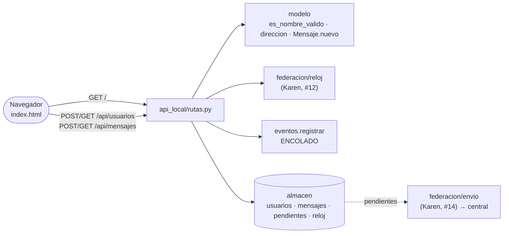

# CD-003 · Canvas REASONS: API local y cliente web

| Campo | Valor |
|---|---|
| ID | CD-003 |
| Historia | [CD-001](../../requirements/CD-001-202611132125-[Story]-chat-distribuido.md): HU2, HU4 (lado del usuario), HU6 (orden al mostrar) y HU9 |
| Análisis | [CD-001 · protocolo y parámetros](../analysis/CD-001-202611141940-[Analysis]-protocolo-y-parametros.md) |
| Base | [CD-002 · estructura](CD-002-202611141940-[Feat]-estructura.md): usa sus contratos de la sección S |
| Issues | [#20](https://github.com/Maria-Fernanda-Ruiz/Chat-distribuido/issues/20), [#21](https://github.com/Maria-Fernanda-Ruiz/Chat-distribuido/issues/21), [#22](https://github.com/Maria-Fernanda-Ruiz/Chat-distribuido/issues/22), [#23](https://github.com/Maria-Fernanda-Ruiz/Chat-distribuido/issues/23); responsable Maria Fernanda |
| Estado | Borrador para aprobación del PM (D15) |
| Revisado por | Pendiente: Javier (PM). El equipo lo revisa en el PR |

Este canvas cubre **lo que ve y usa una persona de nuestro grupo**: crear su usuario,
escribir en `#general` y leer el historial desde el cliente web. No cubre cómo viaja el
mensaje al central (#14, federación) ni cómo llegan los de otros grupos (#13, #18). La
API local solo habla con nuestro servidor; el enunciado la deja libre.

## R · Requirements (requisitos)

**Problema.** Los usuarios del grupo necesitan una forma de entrar al chat, escribir y
leer `#general`, con los mensajes de todos los grupos en el mismo orden lógico que ven
los demás. La API local es la puerta de entrada de nuestros mensajes al sistema: si un
mensaje sale mal armado de aquí (sin `id`, con el reloj mal movido o sin encolar), el
resto de la federación no lo puede arreglar.

**Definición de terminado** (criterios de #20–#23, todos verificables):

1. `POST /api/usuarios` con `{"nombre": "ana"}` responde **201** con
   `{"nombre": "ana", "direccion": "ana@gN"}` (D17).
2. Un nombre que no cumple D12 responde **422**; un nombre que ya existe, **409**. Los
   dos con `{"detail": "…"}` en español que dice qué pasó (D18).
3. `GET /api/usuarios` responde **200** con la lista de usuarios del grupo, cada uno con
   `nombre` y `direccion`.
4. `POST /api/mensajes` con `{"usuario": "ana", "body": "hola"}` responde **201** con el
   mensaje completo en la forma del protocolo: `id` UUID nuevo, `from` = `ana@gN`,
   `origin` = `gN`, `lamport` del reloj, `sent_at` en UTC y `body`.
5. Si el usuario no existe, **404** (D21). Si `body` está vacío, tiene solo espacios o
   pasa de 1 000 caracteres, **422** (D22).
6. El mensaje enviado queda guardado en el historial **y** en la cola de pendientes en la
   misma transacción en que se movió el reloj (salvaguarda 4 de CD-002). Mientras no
   exista el envío al central (#14), se queda como pendiente.
7. `GET /api/mensajes` responde **200** con el historial completo, propio y de otros
   grupos, ordenado por `(lamport, origin, id)`.
8. `GET /api/mensajes?desde_lamport=N` responde solo los mensajes con `lamport > N`, en
   el mismo orden (D19). Un `N` negativo o que no es entero, **422**.
9. `sent_at` viaja en la respuesta y el cliente lo muestra, pero nunca se usa para
   ordenar.
10. `GET /` sirve el cliente web (D23). En él se elige o crea un usuario, se escribe y se
    envía, la lista se actualiza sola cada ~1 s (D07) y los mensajes de otros grupos se
    ven con otro color y con la etiqueta `usuario@gN` (D20). El usuario se elige o se
    crea en la misma pantalla (D25) y cada mensaje muestra su `lamport` junto a la hora
    (D26).
11. Usuarios e historial sobreviven a `docker compose restart`.
12. Punto de control de la etapa 2: dos usuarios del grupo conversan localmente y el
    historial sobrevive a un reinicio.

## E · Entities (entidades)

No hay tablas nuevas: se usan las de CD-002 (`usuarios`, `mensajes`, `pendientes`,
`estado`). Lo nuevo son los modelos de entrada y salida de la API local.

| Modelo | Dirección | Campos | Validación |
|---|---|---|---|
| `UsuarioNuevo` | entrada de `POST /api/usuarios` | `nombre: str` | `modelo.es_nombre_valido` (D12) → si no, 422 |
| `UsuarioSalida` | salida de `/api/usuarios` | `nombre: str`, `direccion: str` | `direccion = modelo.direccion(nombre, grupo)` |
| `MensajeNuevo` | entrada de `POST /api/mensajes` | `usuario: str`, `body: str` | `body.strip()` no vacío y `len(body) <= 1000` (D22) → si no, 422 |
| `Mensaje` | salida de `/api/mensajes` | los del protocolo (CD-002) | se devuelve con `Mensaje.a_json()`, con `from` y no `from_` |

`usuario` en `MensajeNuevo` es el nombre corto (`ana`), no la dirección: el grupo lo pone
el servidor desde la configuración, para que nadie pueda enviar a nombre de otro grupo.

## A · Approach (enfoque)

1. **Rutas bajo `/api`** (D17), en un `APIRouter` de `api_local/rutas.py` que
   `principal.py` incluye. Así quedan separadas de `/fed/…`, que es del central, y del
   cliente en `/`. *Descartado:* `/v1/…` y rutas sin prefijo.
2. **Validación a mano con mensajes en español.** El nombre se valida con
   `modelo.es_nombre_valido` y el texto con una función propia; los errores salen con
   `HTTPException` y `{"detail": "…"}` (norma de CD-002). *Descartado:* dejar el 422
   automático de FastAPI, que responde una lista en inglés difícil de mostrar en el
   cliente.
3. **Repetido = 409, inválido = 422** (D18). El repetido se detecta con el `bool` que
   devuelve `almacen.crear_usuario`, no consultando antes, por la misma razón que la
   deduplicación (CD-002, enfoque 4): entre consultar e insertar puede entrar otra
   petición con el mismo nombre.
4. **Enviar = una sola transacción.** Dentro de `with almacen.transaccion() as tx:` se
   mueve el reloj con la función de Karen (#12), se arma el mensaje con `Mensaje.nuevo`,
   se guarda con `tx.guardar_mensaje_si_no_existe` y se encola con
   `tx.encolar_pendiente(id, ahora)`. Si algo falla, no queda nada a medias. El envío
   real al central lo hace la tarea de fondo de #14, que lee la cola. Para eso la función
   del reloj debe poder usarse dentro de una transacción abierta (P16).
5. **«Lo nuevo» se pide por `lamport`** (D19), como dice #22: el cliente recuerda el
   mayor `lamport` que ya mostró y pide `desde_lamport` con ese valor.
   **Limitación conocida, a propósito:** un mensaje concurrente de otro grupo que llega
   tarde con una marca **menor o igual** a la última mostrada nunca entra en la consulta
   incremental, y el cliente no lo ve hasta recargar la página (que pide todo). El equipo
   lo deja así para **evidenciar** este comportamiento de un sistema distribuido en la
   sesión de interoperabilidad y en el póster, como hallazgo y caso de mejora.
   *Mejora propuesta, no implementada:* pedir por `secuencia` (orden de llegada) con
   `almacen.listar_llegados_despues_de`, que ya existe en CD-002.
6. **Cliente web estático** (D07): un solo `index.html` con JS sin build, servido en `/`
   (D23) con `FileResponse`. Recuerda el nombre elegido en `localStorage` (D12), consulta
   cada segundo y, al recibir mensajes nuevos, los mezcla y vuelve a ordenar por
   `(lamport, origin, id)`. *Descartado:* un framework de frontend, que habría que
   instalar y explicar.
   - Arriba del chat van la lista de usuarios del grupo y un campo para crear uno nuevo
     (D25). *Descartado:* una pantalla de entrada aparte.
   - Cada mensaje muestra `#lamport · hora local`, con la hora sacada de `sent_at` (D26).
     *Descartado:* solo la hora, porque no deja ver por qué los mensajes van en ese orden.
   - El grupo propio, para elegir el color, sale de la `direccion` de los usuarios
     (`ana@g3` → `g3`): no hace falta otra ruta.
   - Si una petición falla, el cliente muestra el `detail` que respondió el servidor y no
     borra lo que se estaba escribiendo.
7. **Dos colores y etiqueta** (D20): los mensajes con `origin` igual a nuestro grupo van
   de un color y los de los demás de otro, y todos muestran `usuario@gN`. *Descartado:*
   un color por grupo y solo etiqueta.

## S · Structure (estructura)

```text
servidor/chat/
  api_local/
    rutas.py            APIRouter /api: usuarios (#20), historial (#22), enviar (#21); GET / (#23)
    estatico/
      index.html        cliente web: HTML + CSS + JS en un archivo (#23)
  almacen.py            + listar_historial_desde_lamport(lamport) (#22): la única consulta nueva
servidor/pruebas/
  test_api_local.py     pruebas de las rutas con TestClient y un almacén en un archivo temporal
  test_almacen.py       + prueba de listar_historial_desde_lamport
```



La API local **no importa** nada de federación salvo `federacion.reloj`, que es la
excepción que permite CD-002 (sección S). No llama al central: deja el mensaje en la cola
y #14 lo envía.

### Rutas

| Método y ruta | Cuerpo | Respuestas |
|---|---|---|
| `POST /api/usuarios` | `{"nombre": "ana"}` | **201** `{"nombre", "direccion"}` · **409** ya existe · **422** nombre inválido |
| `GET /api/usuarios` | — | **200** `[{"nombre", "direccion"}, …]` |
| `POST /api/mensajes` | `{"usuario": "ana", "body": "hola"}` | **201** mensaje del protocolo · **404** usuario no existe · **422** `body` vacío o > 1 000 |
| `GET /api/mensajes` | — | **200** historial completo, ordenado por `(lamport, origin, id)` |
| `GET /api/mensajes?desde_lamport=N` | — | **200** solo `lamport > N`, mismo orden · **422** `N` inválido |
| `GET /` | — | **200** el cliente web (`text/html`) |

## O · Operations (operaciones)

Una rama y un PR por issue (D14), en este orden, todos de Maria Fernanda. Empiezan cuando
este canvas esté aprobado y la estructura (#3–#6) esté en `main`.

1. **Usuarios (#20).**
   - Archivos: `api_local/rutas.py` (`POST` y `GET /api/usuarios`) y
     `pruebas/test_api_local.py`.
   - Se comprueba con pruebas de: crear (201 y la dirección con el grupo de la
     configuración), nombre inválido (mayúsculas, espacios, vacío, 21 caracteres → 422),
     repetido (409), listar, y que el usuario sigue ahí al crear una app nueva sobre el
     mismo archivo de base.
2. **Historial (#22).**
   - Archivos: `almacen.py` (`listar_historial_desde_lamport`, con su prueba en
     `test_almacen.py`), `api_local/rutas.py` (`GET /api/mensajes`) y sus pruebas.
   - Se comprueba con pruebas de: orden por `(lamport, origin, id)` con mensajes propios
     y de otros grupos guardados directo en el almacén; `desde_lamport` devuelve solo lo
     mayor; `desde_lamport` inválido → 422; un `sent_at` desordenado no cambia el orden;
     persistencia al reabrir la base.
   - Además, una prueba que **documenta la limitación de D19**: un mensaje que se guarda
     después con `lamport` menor que el último pedido no aparece en la consulta
     incremental, pero sí en la completa.
3. **Enviar (#21).** Necesita #12 en `main` y P16 cerrado.
   - Archivos: `api_local/rutas.py` (`POST /api/mensajes`) y sus pruebas.
   - Se comprueba con pruebas de: 201 con todos los campos; `id` distinto en cada envío;
     `lamport` que sube en cada envío; usuario inexistente → 404; `body` vacío, solo
     espacios o de 1 001 caracteres → 422 y uno de 1 000 → 201; el mensaje queda en el
     historial **y** en `contar_pendientes()`; el reloj guardado es igual al `lamport`
     del mensaje; se registra el evento `ENCOLADO`.
4. **Cliente web (#23).**
   - Archivos: `api_local/estatico/index.html` y `GET /` en `api_local/rutas.py`.
   - Se comprueba con: una prueba de que `GET /` responde `text/html`, y a mano con
     `docker compose up`: crear dos usuarios en dos pestañas, conversar, ver los colores
     y la etiqueta, hacer `docker compose restart` y ver que el historial sigue (punto de
     control de la etapa 2). Para ver un mensaje de «otro grupo» antes de tener el
     central, se guarda uno con otro `origin` directo en la base o se usan las dos
     instancias locales cuando exista el central simulado (#7).

## N · Norms (normas)

Las de CD-002, más:

- **Rutas en español y en plural:** `/api/usuarios`, `/api/mensajes`. Parámetros en
  `snake_case`: `desde_lamport`.
- **Errores:** siempre `{"detail": "…"}` en español, diciendo qué valor falló y cómo
  corregirlo, porque el cliente muestra ese texto tal cual. Ejemplo:
  `"El nombre «Ana» no es válido: usa de 1 a 20 caracteres entre minúsculas, números, _ y -"`.
- **Sin SQL en las rutas:** todo pasa por `almacen` o por una `Transaccion`.
- **Cliente:** un solo archivo, sin librerías externas ni CDN, para que funcione sin
  internet en la sala. Los textos del usuario se insertan con `textContent`, nunca con
  `innerHTML`.

## S · Safeguards (salvaguardas)

1. **Nunca** se acepta del cliente el `id`, el `origin`, el `lamport` ni el `sent_at`:
   los pone siempre el servidor.
2. **Nunca** se envía a nombre de un usuario que no existe en nuestro grupo (404).
3. **Mover el reloj, guardar el mensaje y encolarlo** pasan en una sola transacción; si
   algo falla, no queda ninguna de las tres cosas.
4. **Nunca** se ordena por `sent_at` ni por la hora de llegada, ni en el servidor ni en el
   cliente.
5. La API local **nunca** llama al central directamente: solo deja el mensaje en la cola.
6. El cliente **nunca** inserta texto de un mensaje como HTML: un `body` con `<script>`
   se muestra como texto.
7. La limitación de D19 se deja **a propósito** y documentada; no se «arregla» en
   silencio. Si el equipo decide cambiarla, primero se ajusta D19 y este canvas.
